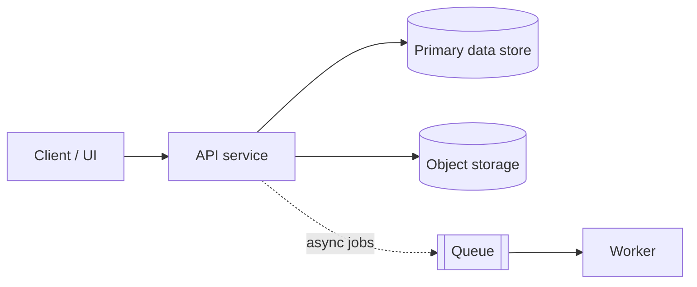

# <PROJECT_NAME>

<!--
  README Template for SDLC-aligned projects — stack-neutral skeleton.

  Instructions:
  1. Replace all <PLACEHOLDER> values with your project-specific content.
  2. The section set below is the default the deployment-readiness review
     checks for (Overview, Prerequisites, Deployment Steps, Usage Guide,
     Configuration Reference, Troubleshooting, Known Issues, License).
     If the project records a different section set in its manifest, that
     set governs instead.
  3. Fill the Architecture, Tech Stack, and Costs sections from THIS
     project's design and cloud — do not leave another project's services,
     prices, or deployment tooling in them.
  4. Remove sections that don't apply (e.g., the Responsible AI section
     if the project has no AI features), and record the removal in the
     manifest so review does not flag the gap.
  5. Delete this comment block when done.
-->

<SHORT_DESCRIPTION — 2–3 sentences: what this solution does, the business
problem it solves, and who it is for.>

[**OVERVIEW**](#overview) | [**QUICK START**](#prerequisites) | [**ARCHITECTURE**](#architecture) | [**SUPPORTING DOCUMENTATION**](#supporting-documentation)

> **Note:** This project follows the SDLC lifecycle defined by the harness packs
> (agents and skills).

> **Responsible AI:** If this project ships AI features, you are responsible for assessing
> associated risks and complying with applicable laws and safety standards.
> Learn more in the [Transparency FAQ](./TRANSPARENCY_FAQ.md).

---

## Overview

<HIGH_LEVEL_DESCRIPTION — the solution, the business problem, target users,
and the overall approach.>

### Business Value

- **<VALUE_1>** — <description>
- **<VALUE_2>** — <description>
- **<VALUE_3>** — <description>

### Use Cases

| Use Case     | Persona   | Challenges   | Approach   |
| ------------ | --------- | ------------ | ---------- |
| <USE_CASE_1> | <PERSONA> | <CHALLENGES> | <APPROACH> |
| <USE_CASE_2> | <PERSONA> | <CHALLENGES> | <APPROACH> |

### Key Features

- <FEATURE_1>
- <FEATURE_2>
- <FEATURE_3>

## Architecture

<ARCHITECTURE_DESCRIPTION — components, how they interact, and the key
design decisions. Replace the starter diagram below with this project's
actual components and services.>



### Tech Stack

| Layer          | Choice                                        |
| -------------- | --------------------------------------------- |
| Language       | <LANGUAGE + VERSION>                          |
| Framework      | <FRAMEWORK>                                   |
| Data store     | <DATA_STORE + approved access library>        |
| Object storage | <OBJECT_STORAGE + approved access library>    |
| Hosting        | <HOSTING — the project's cloud service>       |
| Infrastructure | <IAC_TOOLING — e.g., Bicep, Terraform, CDK>   |
| Deployment     | <DEPLOYMENT_TOOLING>                          |
| CI/CD          | <CI_CD — e.g., GitHub Actions>                |

### Additional Resources

- <ADD_RELEVANT_DOCS — links to the documentation for THIS project's
  stack and cloud services>

---

## Prerequisites

- <CLOUD_ACCOUNT — an account/subscription on the project's cloud with
  permission to create the resources in the design>
- <DEPLOY_TOOLING — the deployment tooling the project uses, with the
  minimum version>
- <RUNTIMES — language runtimes and package managers from the stack
  profile, with versions>
- [Docker](https://www.docker.com/get-started/) (for Dev Containers / local containers, if used)

## Deployment Steps

```bash
# 1. Clone the repository
git clone https://github.com/<ORG>/<REPO>.git
cd <REPO>

# 2. Authenticate to the project's cloud
<LOGIN_COMMAND>

# 3. Provision infrastructure and deploy
<DEPLOY_COMMAND>

# 4. (Optional) Configure environment per service
<CONFIG_STEP — e.g., copy each service's .env.example to .env and fill in
the settings from the Configuration Reference below>
```

<PRE_DEPLOY_CHECKS — quota, region availability, or licensing checks this
project must pass before deploying, with links to its own runbooks.>

## Usage Guide

<HOW_TO_USE — the primary user flows, entry points, and example requests
or commands. Link to the API documentation where one exists.>

## Configuration Reference

| Setting          | Where set        | Description            |
| ---------------- | ---------------- | ---------------------- |
| <SETTING_1>      | <ENV / FILE>     | <DESCRIPTION>          |
| <SETTING_2>      | <ENV / FILE>     | <DESCRIPTION>          |

## Costs

Pricing varies per region and usage. Estimate this project's cost with
your cloud provider's pricing calculator, listing the actual services
from the Tech Stack table above.

> ⚠️ **Important:** To avoid unnecessary costs, tear down the deployment
> when it is no longer in use: `<TEARDOWN_COMMAND>`

## Troubleshooting

| Symptom          | Likely cause     | Fix                  |
| ---------------- | ---------------- | -------------------- |
| <SYMPTOM_1>      | <CAUSE>          | <FIX>                |
| <SYMPTOM_2>      | <CAUSE>          | <FIX>                |

## Known Issues

- <KNOWN_ISSUE_1 — or "None known at this time.">

---

## Supporting Documentation

### Development

**Prompt files** for Copilot-assisted development:

| Phase                  | Prompt File                                                                                 |
| ---------------------- | ------------------------------------------------------------------------------------------- |
| Requirements & Design  | [`.github/prompts/requirement-and-design.prompt.md`](/.github/prompts/requirement-and-design.prompt.md)     |
| Repo Structure & CI/CD | [`.github/prompts/repo-structure-and-cicd.prompt.md`](/.github/prompts/repo-structure-and-cicd.prompt.md)   |
| Deployment & Infra     | [`.github/prompts/deployment.prompt.md`](/.github/prompts/deployment.prompt.md)                             |
| Implementation & Tests | [`.github/prompts/implementation-and-tests.prompt.md`](/.github/prompts/implementation-and-tests.prompt.md) |
| Documentation          | [`.github/prompts/repo-documentation.prompt.md`](/.github/prompts/repo-documentation.prompt.md)             |
| QA, RAI & Release      | [`.github/prompts/qa-rai-release.prompt.md`](/.github/prompts/qa-rai-release.prompt.md)                     |

| Resource                                    | Description                      |
| ------------------------------------------- | -------------------------------- |
| [Stack Profiles](/skills/sdlc-stack-profiles/SKILL.md) | Reusable libraries and templates |

### Security Guidelines

- Use the cloud's managed/workload identity for service authentication —
  never connection strings or long-lived keys in code or configuration.
- Store secrets in the cloud's secret manager, referenced by the services
  that need them.
- Enable [GitHub secret scanning](https://docs.github.com/code-security/secret-scanning/about-secret-scanning).
- <PROJECT_SPECIFIC_MEASURES — network isolation, firewall, scanning,
  or compliance controls this project's design requires.>

### Cross References

| Related Project     | Description   |
| ------------------- | ------------- |
| <RELATED_PROJECT_1> | <DESCRIPTION> |
| <RELATED_PROJECT_2> | <DESCRIPTION> |

---

## Provide Feedback

Have questions, find a bug, or want to request a feature?
[Submit a new issue](https://github.com/<ORG>/<REPO>/issues) and we'll connect.

## Responsible AI Transparency FAQ

<!-- Only for projects with AI features; remove this section otherwise
     (and record the removal per the header instructions). -->

Please refer to [Transparency FAQ](./TRANSPARENCY_FAQ.md) for responsible AI transparency details.

## License

<LICENSE — the project's license; the repository is created with the
organization's default (MIT template unless the intake recorded another).>

## Disclaimers

<ORG_DISCLAIMER — your organization's standard disclaimer text.>

<!-- Optional, only for projects that ship AI-generated output:

This release includes an artificial intelligence (AI) system that generates
content based on user input. Generated content may include ungrounded
material that is not verified by any reliable source. Users are responsible
for determining the accuracy, validity, and suitability of any generated
content for their intended purposes.

This release does not reflect the opinions, views, or values of <ORG> or any
of its affiliates, subsidiaries, or partners.
-->
