<!--
IMPORTANT: This file is a TUTORIAL FOR HUMANS ONLY.
AI agents and Copilot MUST NOT use this file as instructions, context, or a source of
code patterns. The sample "Document Manager" application described here is fictional
and used solely for educational purposes.

Agents work from their own agent files and the workspace files deployed at
initialization (.github/copilot-instructions.md, .github/instructions/, .github/prompts/,
and the project's .github/reference-catalog.md) — NOT from this hands-on guide.
-->

# Hands-On Guide: SDLC Harness — End-to-End Walkthrough

> **⚠️ This document is for human readers only.** It is a tutorial walkthrough with a
> fictional sample application. AI agents should not use this file for code generation,
> design decisions, or as a reference for real implementations.

This guide walks you through one complete delivery with the **SDLC Harness** plugin —
21 agents and 24 skills that run a nine-phase SDLC with enforced quality gates.
By following every step, you'll see how the **Harness** orchestrator, its phase
agents, and the **prompt files** work together to deliver a production-ready
application.

> **Two ways to work:** Each step shows the **agent-driven** approach (talking to the
> Harness agent) and the **manual prompt** approach (using the prompt files directly).
> Both produce the same result — choose whichever fits your workflow.

The walkthrough builds three services, so the run is graded **Large**: the full
ceremony applies, including a three-round QA re-review budget.

## Sample Application: Document Manager

A full-stack application that lets users upload, browse, and download documents —
with an AI agent that automatically analyzes, summarizes, and answers questions about
document content.

| Component   | Technology                              | Purpose                                    |
| ----------- | --------------------------------------- | ------------------------------------------ |
| **API**     | Python 3.12 + FastAPI (`python/api`)    | REST endpoints for document CRUD           |
| **Web**     | Next.js + TypeScript (`typescript/web`) | Upload/browse/download UI + chat interface |
| **Agent**   | Python 3.12 + Azure AI Foundry          | Document analysis, summarization, and Q&A  |
| **Data**    | Azure Cosmos DB                         | Document metadata + analysis results       |
| **Files**   | Azure Blob Storage                      | Document file storage                      |
| **AI**      | Azure AI Foundry (OpenAI models)        | LLM inference for the agent service        |
| **Hosting** | Azure Container Apps                    | API, Web, and Agent in a shared environment |
| **Infra**   | Bicep + AVM                             | Infrastructure as Code                     |
| **Deploy**  | Azure Developer CLI (`azd`)             | One-command deployment                     |

Data access goes through the project's approved Cosmos DB and Storage libraries —
the ones recorded in the project's **reference catalog** (`.github/reference-catalog.md`),
which the harness creates when the workspace is initialized and keeps current as
patterns are adopted.

---

## Prerequisites

- The **SDLC Harness plugin** installed — see the [README](../README.md) Quick Start
  (VS Code or Copilot CLI)
- [Git](https://git-scm.com/) and a GitHub account
- [Python 3.12+](https://www.python.org/downloads/) with the
  [uv](https://docs.astral.sh/uv/) package manager
- [Node.js 20+](https://nodejs.org/) (for the web frontend)
- [Docker](https://www.docker.com/get-started/) (for MCP servers and dev containers)
- [Azure Developer CLI (azd)](https://learn.microsoft.com/en-us/azure/developer/azure-developer-cli/install-azd)
- [Azure CLI](https://learn.microsoft.com/en-us/cli/azure/install-azure-cli)
- An Azure subscription with permissions to create resources

---

## Step 0: Create the Project and Initialize the Workspace (Phase 0)

### 0.1 Create an empty repository

```bash
mkdir document-manager && cd document-manager
git init
```

Open the folder in VS Code (`code .`) or start Copilot CLI in it.

### 0.2 Let Harness initialize the workspace

Select the **Harness** agent in Copilot Chat and say:

```text
/agent harness
Initialize this workspace for a new project called document-manager.
```

On first run, Harness detects the missing workspace files and deploys them
(Phase 0 — workspace init):

| File | What it is |
| ---- | ---------- |
| `.vscode/mcp.json` | MCP server configuration — 7 servers: **GitHub**, **Azure**, **Azure DevOps**, **Microsoft Learn**, **Context7**, **Playwright**, **awesome-copilot** |
| `.github/copilot-instructions.md` | Project instructions, customized with your project name, domain, stack, and cloud |
| `.github/instructions/` | The 14 quality instruction files (code quality + test quality per language) |
| `.github/prompts/` | The 6 SDLC prompt files used by the manual approach |
| `.github/reference-catalog.md` | The project reference catalog — approved libraries and patterns, populated as the project adopts them |

Harness asks for the values it cannot infer (project name, business domain,
cloud target) and fills the rest progressively: the Analyst records the tech
stack and architecture style at design time, the Deployer records the Azure
services at infrastructure time. You never edit placeholders by hand.

### 0.3 Verify the setup

| 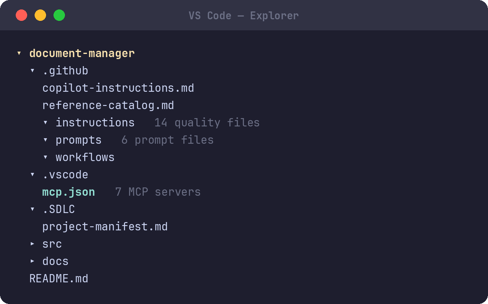 |
| ------------------------------------------------------------------------------ |
| *VS Code showing the initialized workspace: .github/ with instructions and prompts, .vscode/mcp.json, and the project manifest under .SDLC/* |

Check that:

- Copilot Chat's agent dropdown lists **Harness**
- `.vscode/mcp.json` lists the 7 MCP servers above
- `.github/copilot-instructions.md` names your project with no blocking
  placeholders left

---

## Step 1: Requirements & Design (Phases 1–2)

### Option A: Agent-driven (recommended)

```text
/agent harness
Design a Document Manager application that allows users to
upload, browse, download, and delete documents (PDF, DOCX, images) with metadata.
Include an AI agent that summarizes content and answers questions via chat.
Use the approved Cosmos DB library for metadata, the approved Storage library
for files, and deploy to Container Apps.
```

Harness delegates to the **Analyst** agent, which:

1. Runs a short requirements-discovery pass — expect a few clarifying
   questions before any design is proposed
2. Consults the project reference catalog for approved libraries and templates
3. Returns a structured design proposal and records it as an ADR

### Option B: Manual prompt file

```
Use .github/prompts/requirement-and-design.prompt.md for this feature:

Build a Document Manager application that allows users to:
1. Upload documents (PDF, DOCX, images) with metadata (title, description, tags)
2. Browse and search documents by metadata
3. Download documents
4. Delete documents
5. Automatically analyze uploaded documents using an AI agent that:
   - Summarizes document content
   - Extracts and suggests tags
   - Answers natural language questions about documents via a chat interface

The API should use the approved Cosmos DB library for document metadata and the
approved Storage library for file storage.
The agent service should use Azure AI Foundry for LLM inference and MCP tools
for document access.
The web frontend should be Next.js with TypeScript, including a chat panel for Q&A.
All three services (API, Agent, Web) should deploy to Azure Container Apps in a
shared environment.

Constraints:
- Max file size: 50MB
- Documents must be scoped per user (multi-tenant)
- Must support Microsoft Entra ID authentication
- Agent must use Managed Identity for Azure AI Foundry access
```

### Expected output

| 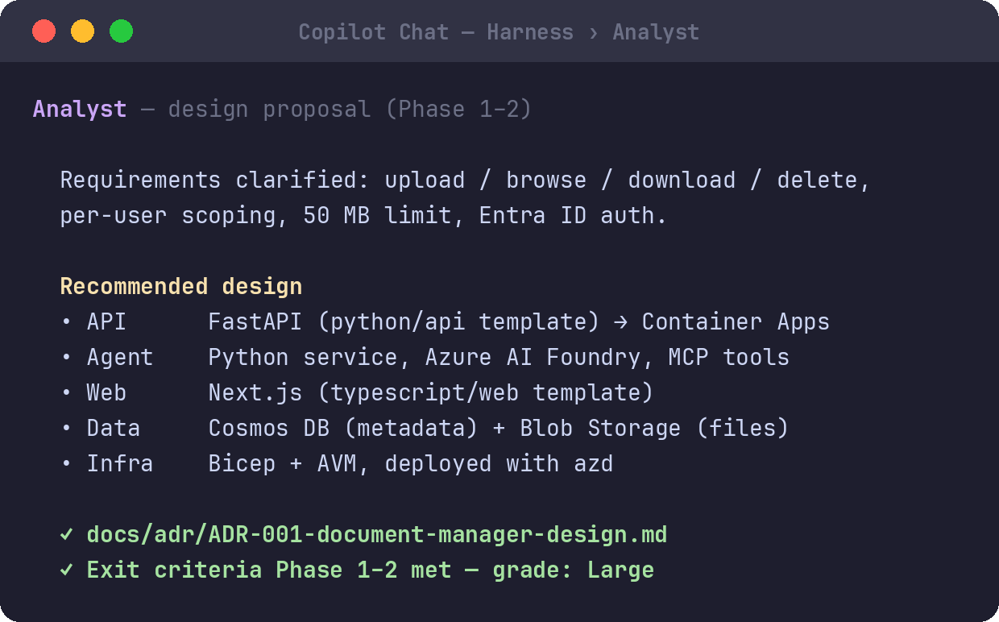 |
| ---------------------------------------------------------------------------------- |
| *The Analyst's design proposal: clarified requirements, the recommended design, and the Phase 1–2 exit check* |

Copilot should return:

- ✅ Clarified requirements (problem statement, goals, non-goals)
- ✅ Recommended design with architecture diagram
- ✅ Data model (Cosmos DB entities behind the repository pattern)
- ✅ API endpoints list
- ✅ Azure services mapping
- ✅ SDLC impact by phase
- ✅ Exit Criteria Check (Phases 1–2)

### Save the output

The design is recorded as `docs/adr/ADR-001-document-manager-design.md`.
The ADR is a Phase 2 decision record — it must exist as a file before the
Phase 1–2 exit gate can pass.

---

## Step 2: Scaffold Repo Structure & CI/CD (Phase 3)

### Option A: Agent-driven

```text
/agent harness
Set up the repo structure for the Document Manager.
API: Python FastAPI, Agent: AI agent service, Web: Next.js TypeScript.
All 3 services deploy to Container Apps in a shared environment.
Follow the design in docs/adr/ADR-001-document-manager-design.md.
```

Harness delegates to the **Scaffolder** agent — this delegation is a hard gate:
Phase 3 does not proceed any other way. The Scaffolder:

1. Instantiates the bundled stack-profile templates (`python/api` for the API
   and agent services, `typescript/web` for the frontend)
2. Adds CI/CD workflows, Dockerfiles, and per-service configuration
3. Records every template and pattern choice in `.SDLC/project-manifest.md`

### Option B: Manual prompt file

```
Use .github/prompts/repo-structure-and-cicd.prompt.md to:

Set up the repo structure for the Document Manager application.
- API: Python FastAPI (python/api template)
- Agent: Python AI agent service (python/api template)
- Web: Next.js TypeScript frontend (typescript/web template)
- CI/CD: GitHub Actions
- Deployment: Azure Container Apps (all 3 services in shared environment)
- All services need Dockerfiles

Follow the design in docs/adr/ADR-001-document-manager-design.md.
```

### Expected output

- ✅ Folder structure (api/, agent/, web/ under `src/`)
- ✅ `pyproject.toml` per Python service, with the approved Cosmos DB and
  Storage libraries
- ✅ `package.json` for the Next.js frontend
- ✅ `.github/workflows/ci.yml` — build, lint, test (all 3 services)
- ✅ `.github/workflows/deploy.yml` — deploy to Container Apps
- ✅ `Dockerfile` per service, `.gitignore`, `.dockerignore`
- ✅ `.SDLC/project-manifest.md` updated with the chosen templates
- ✅ Exit Criteria Check (Phase 3)

| 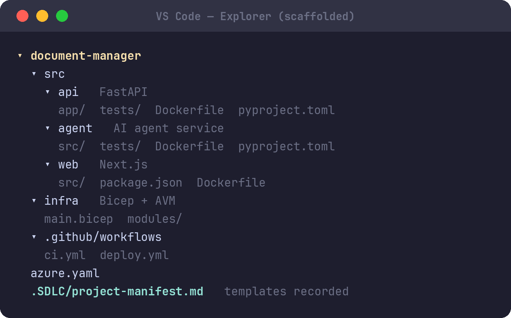 |
| ---------------------------------------------------------------------------- |
| *VS Code explorer showing the scaffolded layout: three services under src/, infra/, workflows, and the project manifest* |

```
document-manager/
├── src/                          # All services under src/
│   ├── api/                      # FastAPI backend (python/api template)
│   │   ├── app/                  # main.py, routers/, services/, models/, repositories/
│   │   ├── tests/
│   │   ├── Dockerfile
│   │   └── pyproject.toml
│   ├── agent/                    # AI agent service (python/api template)
│   │   ├── src/                  # main.py, agents/, tools/
│   │   ├── tests/
│   │   ├── Dockerfile
│   │   └── pyproject.toml
│   └── web/                      # Next.js frontend (typescript/web template)
│       ├── src/                  # app/, components/, hooks/
│       ├── Dockerfile
│       └── package.json
├── infra/                        # Bicep + AVM (generated in Step 3)
├── .github/
│   ├── workflows/                # ci.yml, deploy.yml
│   ├── copilot-instructions.md
│   ├── reference-catalog.md
│   ├── instructions/             # Quality instruction files (deployed in Step 0)
│   ├── prompts/                  # Prompt files (deployed in Step 0)
│   └── PULL_REQUEST_TEMPLATE.md
├── .SDLC/
│   └── project-manifest.md       # Templates and patterns chosen for this project
├── docs/
│   └── adr/ADR-001-document-manager-design.md
├── azure.yaml
└── README.md
```

---

## Step 3: Deploy Infrastructure (Phases 3 + 8, Checkpoint 3B)

### Option A: Agent-driven

```text
/agent harness
Create the deployment infrastructure for the Document Manager.
We need Cosmos DB, Blob Storage, Container Apps (3 services), Container Registry,
Azure AI Foundry, Key Vault, and monitoring. Use AVM modules.
Deploy to East US.
```

Harness delegates to the **Deployer** agent, which:

1. Designs the Bicep infrastructure with Azure Verified Modules (AVM)
2. Validates module versions and resource configurations via Azure MCP
3. Pulls current AVM and service documentation from Microsoft Learn MCP
4. Wires `azure.yaml` so `azd` provisions and deploys in one command

### Option B: Manual prompt file

```
Use .github/prompts/deployment.prompt.md to create the deployment infrastructure for
the Document Manager application. We need:

- Cosmos DB (SQL API) for document metadata via the approved Cosmos DB library
- Blob Storage for document files via the approved Storage library
- Container Apps for API, Agent, and Web (all 3 in a shared environment)
- Container Registry for Docker images
- Azure AI Foundry with an OpenAI model deployment (for the agent service)
- Key Vault for secrets
- Log Analytics + App Insights for monitoring

Use AVM modules from the public Bicep registry.
Deploy to East US.
```

### Expected output

- ✅ `infra/main.bicep` — AVM modules throughout, no hardcoded values
- ✅ `infra/main.parameters.json` — environment defaults
- ✅ `infra/modules/` — per-resource wrappers (Cosmos DB, storage, Container
  Apps environment + apps, registry, AI Foundry, Key Vault, monitoring)
- ✅ `azure.yaml` — multi-service (api + agent + web)
- ✅ Infrastructure validation (**Checkpoint 3B**): modules compile and the
  resource configuration validates before anything is deployed
- ✅ Exit Criteria Check (Phases 3 + 8)

### Deploy to Azure

```bash
# Login
azd auth login

# Provision infrastructure and deploy
azd up
```

| 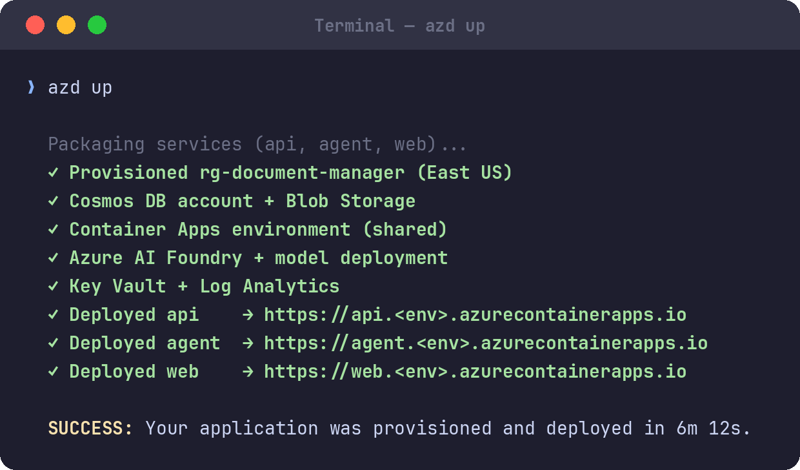 |
| ------------------------------------------------------------------------------- |
| *Terminal showing azd up provisioning the Azure resources and deploying the three Container Apps* |

| 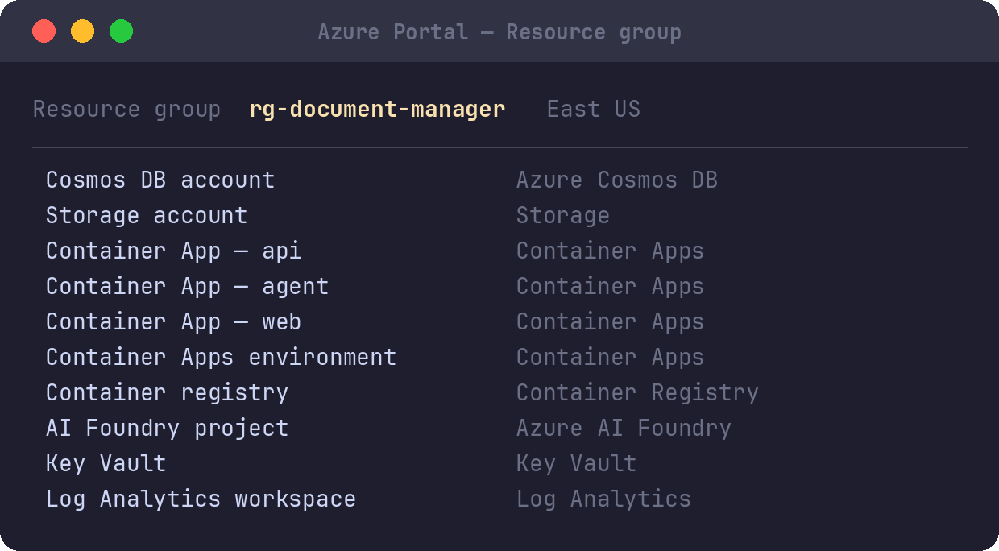 |
| ----------------------------------------------------------------- |
| *The deployed resource group: Cosmos DB, Storage, the three Container Apps, AI Foundry, Key Vault, and monitoring* |

---

## Step 4: Implement the API (Phase 4)

### Option A: Agent-driven

```text
/agent harness
Implement the Document Manager API with these endpoints:
POST /api/documents, GET /api/documents, GET /api/documents/{id},
GET /api/documents/{id}/download, DELETE /api/documents/{id}.
Use the approved Cosmos DB library and the approved Storage library. Follow ADR-001.
```

Harness delegates to the **Implementer** agent, which:

1. Writes a **sprint contract** first — the acceptance criteria it will be
   measured against — before any code
2. Verifies the approved libraries against the project reference catalog
3. Loads current framework documentation via Context7 MCP (FastAPI, Pydantic)
4. Works in a strict **code → unit test → next layer** sequence:
   entity → repository → service → route, testing each layer as it lands —
   never batching tests at the end
5. Runs the full suite with coverage before reporting back

### Option B: Manual prompt file

```
Use .github/prompts/implementation-and-tests.prompt.md to implement:

The Document Manager API with these endpoints:
- POST /api/documents — upload document (metadata to Cosmos DB, file to Blob Storage)
- GET /api/documents — list documents for current user
- GET /api/documents/{id} — get document metadata
- GET /api/documents/{id}/download — download document file
- DELETE /api/documents/{id} — delete document and file

Use the approved Cosmos DB library with a DocumentRepository behind the
repository pattern. Use the approved Storage library for file operations.

Follow the design in docs/adr/ADR-001-document-manager-design.md.
```

### Expected output

Copilot generates the layered implementation, each layer with its tests. The
service layer shows the shape of the whole design — metadata and file
operations orchestrated behind two approved libraries:

| 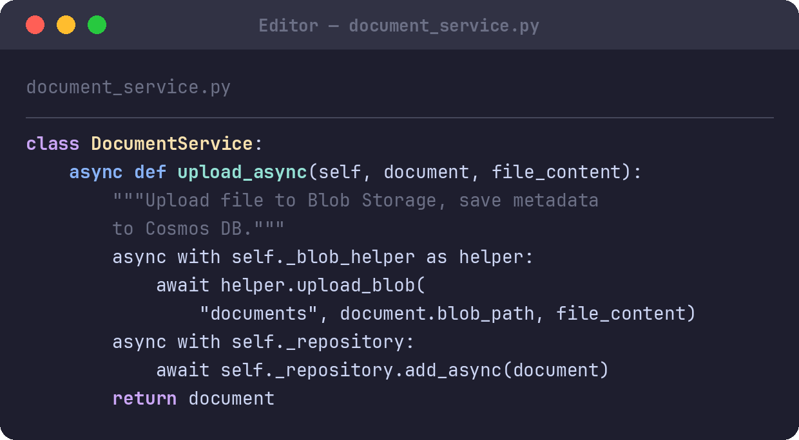 |
| -------------------------------------------------------------------------------- |
| *The generated DocumentService: Blob Storage upload and Cosmos DB metadata save behind the repository pattern* |

```python
class DocumentService:
    """Orchestrates document metadata and file operations."""

    async def upload_async(self, document, file_content: bytes):
        """Upload file to Blob Storage, save metadata to Cosmos DB."""
        async with self._blob_helper as helper:
            await helper.upload_blob("documents", document.blob_path, file_content)
        async with self._repository:
            await self._repository.add_async(document)
        return document
```

### Verify

```bash
# Install API dependencies and run its tests
cd src/api && uv sync
uv run pytest tests/ -v --cov=app --cov-report=term-missing
cd ../..
```

| 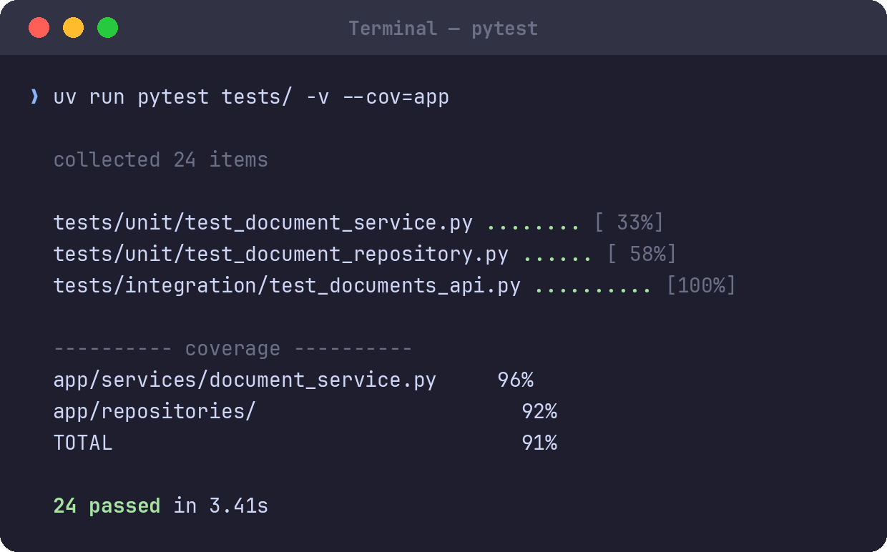 |
| ------------------------------------------------------------------ |
| *pytest: the API suite green with the coverage report*            |

---

## Step 4b: Implement the AI Agent Service (Phase 4)

Still with the implementation prompt:

```
Use .github/prompts/implementation-and-tests.prompt.md to implement:

The Document Manager AI Agent service:

1. Document Analyzer Agent — triggered after document upload:
   - Reads the document from Blob Storage via an MCP tool
   - Summarizes the content using Azure AI Foundry
   - Extracts topic tags
   - Saves analysis results to Cosmos DB via the approved Cosmos DB library

2. Document Q&A Agent — chat endpoint:
   - Receives natural language questions about a specific document
   - Retrieves document content from Blob Storage via an MCP tool
   - Generates answers using Azure AI Foundry
   - Returns streaming responses

Use Managed Identity (DefaultAzureCredential) for Azure AI Foundry access.
Ground every answer in the retrieved document content and cite the source.
```

### Expected output

- ✅ `src/agent/src/agents/document_analyzer.py` — summarization + tag extraction
- ✅ `src/agent/src/agents/document_qa.py` — grounded Q&A with citations
- ✅ `src/agent/src/tools/` — MCP tools wrapping Blob reads
- ✅ Unit tests with the AI client and MCP context mocked

| 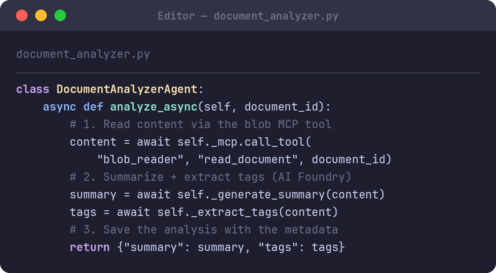 |
| --------------------------------------------------------------------- |
| *The DocumentAnalyzerAgent: read via MCP tool, summarize and tag with AI Foundry, save the analysis* |

### Verify

```bash
cd src/agent && uv run pytest tests/ -v
cd ../..
```

---

## Step 5: Implement the Web Frontend (Phase 4)

```
Use .github/prompts/implementation-and-tests.prompt.md to implement:

The Document Manager web frontend (Next.js + TypeScript) with:
- Document upload form (drag & drop + file picker)
- Document list view with search/filter by tags
- Document detail view with download button + AI-generated summary display
- Chat panel for asking questions about documents (connects to the agent Q&A endpoint)
- Delete confirmation dialog

Use React functional components with TypeScript.
Fetch data from the API endpoints implemented in Step 4.
```

### Expected output

Copilot generates components that follow `code-quality-tsx.instructions.md`:

- `web/src/components/DocumentUpload.tsx`
- `web/src/components/DocumentList.tsx`
- `web/src/components/DocumentDetail.tsx`
- `web/src/components/ChatPanel.tsx` — streaming Q&A chat with the agent
- `web/src/hooks/useDocuments.ts`, `web/src/hooks/useChat.ts`
- Component tests alongside (`DocumentList.test.tsx`, `ChatPanel.test.tsx`, …)

### Verify

```bash
cd src/web
pnpm install
pnpm test
pnpm build
cd ../..
```

| 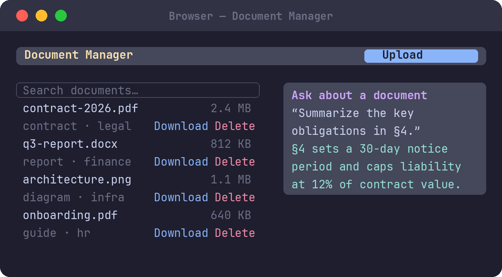 |
| -------------------------------------------------------------- |
| *The Document Manager web app: document list with upload, search, and download — and the Q&A chat panel* |

---

## Step 6: QA Review (Phase 6)

### Option A: Agent-driven panel review (recommended)

```text
/agent harness
Run a full QA review on the Document Manager implementation.
```

Harness first assembles an **evidence pack** — the changed artifacts, the full
test-run output, runtime probes (boot smoke, health check, one read path per
resource), and CI evidence. An app that cannot boot never reaches the panel.
The **QA Coordinator** then runs **9 reviewers in parallel**, each in its own
context window, each with an adversarial posture ("do not be generous, do not
downgrade findings"):

| Reviewer | Checks | Threshold |
| -------- | ------ | --------- |
| Architecture | Layering rules, dependency boundaries, pattern consistency | ≥ 7 |
| Azure Compliance | Approved library usage, no raw SDK calls, identity best practices | ≥ 7 |
| Code Quality | Naming, docstrings, dead code | ≥ 7 |
| Security | Secrets, injection, authorization (OWASP loaded fresh) | **≥ 8** |
| Test Coverage | Runs the tests, coverage, assertion quality | ≥ 7 |
| Requirements Completeness | Every requirement and acceptance criterion addressed | ≥ 7 |
| UX & Accessibility | ARIA labels, keyboard navigation, dark mode, error boundaries | ≥ 7 |
| LLM Behavior | Prompt safety, grounding, citations, content filters | ≥ 7 |
| Deployment Readiness | Error handling, performance patterns, observability, README | ≥ 7 |

The compliance slot follows the project's cloud pack — this walkthrough runs
the Azure reviewer; an AWS or GCP project gets its own in the same slot.

Scores combine into a weighted composite (Security counts ×1.5). The verdict
fails automatically on: any **Critical** finding, Security below 8, any domain
below 5, or a composite below 7.

| 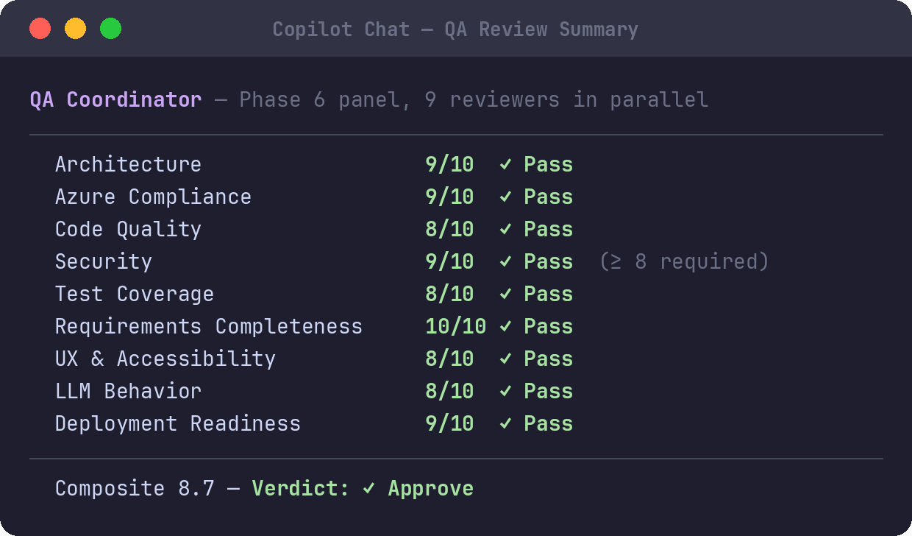 |
| ---------------------------------------------------------- |
| *The Phase 6 panel result for the walkthrough: all nine reviewers pass, composite 8.7* |

### When the verdict fails

Harness delegates the fixes to the Implementer, then the panel runs a
**delta re-review**: only the changed ranges in the failing domains are
re-scored — untouched domains keep their scores. This walkthrough is graded
Large, so the budget is **3 rounds** (Small tasks get 2). Suggestions never
consume a round. The Coordinator also produces a manual QA checklist for
items that need human testing and can file the failures as GitHub issues.

### Option B: Manual quality pass

The quality instruction files auto-apply while Copilot edits files. For a
manual pass, ask explicitly:

```
Run a systematic code-quality pass on src/api/app/ following
.github/instructions/code-quality-py.instructions.md. Check every Python file for:
copyright headers, docstrings, comment cleanup, dead code, then compile-check.
```

```
Run a test quality pass on src/api/tests/ following
.github/instructions/test-quality.instructions.md.
Sanitize existing tests, identify gaps, and write missing tests.
```

```
Run a code-quality pass on src/web/src/ following
.github/instructions/code-quality-tsx.instructions.md.
```

### Verify all tests pass

```bash
# Python services
cd src/api && uv run pytest tests/ -v --cov=app && cd ../..
cd src/agent && uv run pytest tests/ -v && cd ../..

# Web frontend
cd src/web && pnpm test -- --coverage && cd ../..
```

---

## Step 7: Documentation (Phase 5)

### Option A: Agent-driven

```text
/agent harness
Create SDLC-aligned documentation for the Document Manager.
Include a project README, API docs, and update the ADR with implementation details.
```

Harness delegates to the **Documenter** agent, which writes from the actual
code — template compliance, no placeholders, working links — and updates the
ADR with what was really built.

### Option B: Manual prompt file

```
Use .github/prompts/repo-documentation.prompt.md to create SDLC-aligned documentation
for the Document Manager application.

Create:
1. Project README.md following the application template in .design/README.template.md
2. API documentation for the /api/documents endpoints
3. Update the ADR with implementation details

Target audience: internal developers and operations team.
```

### Expected output

- ✅ `README.md` — Solution Overview, Quick Deploy, Business Scenario
- ✅ `docs/api/documents.md` — endpoint documentation
- ✅ Updated `docs/adr/ADR-001-document-manager-design.md`
- ✅ Exit Criteria Check (Phase 5)

---

## Step 8: RAI Review & Release Preparation (Phases 7–8)

Phase 7 applies to this walkthrough: the agent service summarizes documents
and answers questions about them, so responsible-AI review is mandatory.

### RAI review

```text
/agent harness
Run a RAI review on the Document Manager.
The agent service uses Azure AI Foundry for document summarization and Q&A.
```

The **RAI Reviewer** assesses prompt-injection risk (uploaded documents are
untrusted input), data leakage across users, grounding and citation quality,
and content-filter configuration. A ⛔ verdict blocks Phase 8 until you
decide how to proceed; a ⚠️ is recorded and carried into the release notes.

### Release preparation

```text
/agent harness
Prepare a release for the Document Manager.
Create a PR with changelog targeting the main branch.
```

The **Release Manager** gathers the commit history, drafts the changelog,
checks every phase's exit criteria, and prepares the Phase 9 publish.

### Option B: Manual prompt file

```
Use .github/prompts/qa-rai-release.prompt.md for the Document Manager application.

Summary: Full-stack document management with upload/browse/download/delete.
Uses Cosmos DB for metadata, Blob Storage for files, Container Apps for hosting,
and an AI agent service for summarization and Q&A.

Risk areas:
- File upload security (malware, oversized files)
- Multi-tenant data isolation (user scoping)
- Blob Storage access control
- Prompt injection via uploaded document content
- Ungrounded answers in the Q&A chat
```

### Expected output

- ✅ QA Plan (automated tests to run, manual scenarios)
- ✅ RAI Review — prompt injection, data isolation, grounding
- ✅ Release Checklist (CI checks, staging validation, monitoring)
- ✅ Exit Criteria Check (Phases 7–8)

---

## Step 9: Create the PR & Publish (Phase 9)

### Create a branch and PR

```bash
git checkout -b feature/document-manager
git add .
git commit -m "feat: Document Manager - full-stack implementation

- FastAPI API with the approved Cosmos DB library + the approved Storage library
- AI Agent service with Azure AI Foundry + MCP tools
- Next.js TypeScript frontend with chat panel
- Bicep/AVM infrastructure with Container Apps
- Unit tests + integration tests
- Project README + ADR documentation

SDLC Phases: 0-9 complete"

git push origin feature/document-manager
```

### Create the PR on GitHub

| 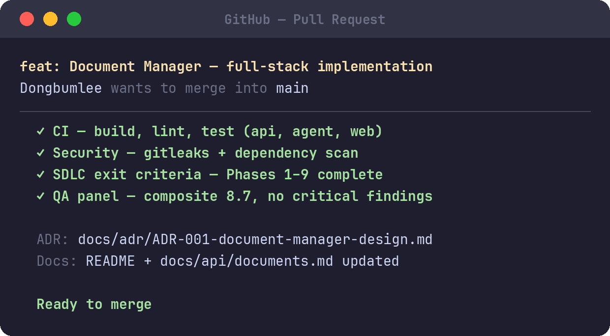 |
| -------------------------------------------------------------------- |
| *The pull request: CI and security checks green, the QA panel verdict attached, phases 1–9 checked off* |

The PR template (`.github/PULL_REQUEST_TEMPLATE.md`) auto-populates. Fill in:

- **SDLC Phase**: Check all boxes (end-to-end run)
- **Copilot Prompts Used**: Check all 6
- **Azure Resources**: Cosmos DB, Blob Storage, Container Apps, AI Foundry
- **Testing**: All boxes checked
- **Documentation**: ADR + API docs + README
- **Design Reference**: `docs/adr/ADR-001-document-manager-design.md`

### Review & merge

- Enable Copilot code review on the PR
- Address any review comments
- Verify the CI pipeline passes
- Merge to main

---

## Validation Checklist

After completing all steps, verify:

### Files created

| File | Phase | Source |
| ---- | ----- | ------ |
| `.vscode/mcp.json`, `.github/copilot-instructions.md` | 0 | Workspace init (Harness) |
| `.github/instructions/`, `.github/prompts/`, `.github/reference-catalog.md` | 0 | Workspace init (Harness) |
| `docs/adr/ADR-001-*.md` | 1–2 | Analyst agent or `requirement-and-design.prompt.md` |
| `src/api/`, `src/agent/`, `src/web/` structure | 3 | Scaffolder agent or `repo-structure-and-cicd.prompt.md` |
| `.github/workflows/` | 3 | Scaffolder agent or `repo-structure-and-cicd.prompt.md` |
| `.SDLC/project-manifest.md` | 3 | Scaffolder (updated every phase) |
| `infra/` Bicep + AVM, `azure.yaml` | 3 + 8 | Deployer agent or `deployment.prompt.md` |
| `src/api/app/models/`, `repositories/`, `services/`, `routers/` | 4 | `implementation-and-tests.prompt.md` |
| `src/agent/src/agents/`, `src/agent/src/tools/` | 4 | `implementation-and-tests.prompt.md` |
| `src/web/src/components/`, `src/web/src/hooks/` | 4 | `implementation-and-tests.prompt.md` |
| `README.md`, `docs/api/documents.md` | 5 | Documenter agent or `repo-documentation.prompt.md` |

### Quality standards verified

- [ ] All `.py` files have copyright headers and docstrings
- [ ] All `.tsx` files have copyright headers and JSDoc
- [ ] No dead code, unused imports, or commented-out code
- [ ] All tests pass: `uv run pytest` (api, agent) + `pnpm test` (web)
- [ ] Coverage above 80%
- [ ] `python -m py_compile` passes on all Python files
- [ ] TypeScript type-check passes (`pnpm build` or `tsc --noEmit`)

### Prompts used

- [ ] `.github/prompts/requirement-and-design.prompt.md` — Phases 1–2
- [ ] `.github/prompts/repo-structure-and-cicd.prompt.md` — Phase 3
- [ ] `.github/prompts/deployment.prompt.md` — Phases 3 + 8
- [ ] `.github/prompts/implementation-and-tests.prompt.md` — Phase 4
- [ ] `.github/prompts/repo-documentation.prompt.md` — Phase 5
- [ ] `.github/prompts/qa-rai-release.prompt.md` — Phases 6–8

### Quality instruction files activated

- [ ] `.github/instructions/code-quality-py.instructions.md` — when editing `.py` files
- [ ] `.github/instructions/code-quality-ts.instructions.md` — when editing `.ts` files
- [ ] `.github/instructions/code-quality-tsx.instructions.md` — when editing `.tsx` files
- [ ] `.github/instructions/test-quality.instructions.md` — when editing Python tests
- [ ] `.github/instructions/test-quality-ts.instructions.md` — when editing `*.test.ts`
- [ ] `.github/instructions/test-quality-tsx.instructions.md` — when editing `*.test.tsx`

### Agents used (agent-driven workflow)

- [ ] **Harness** — orchestrated all phases
- [ ] **Analyst** — Phases 1–2 design
- [ ] **Scaffolder** — Phase 3 repo structure
- [ ] **Deployer** — Phases 3 + 8 infrastructure
- [ ] **Implementer** — Phase 4 code + tests
- [ ] **QA Coordinator** — Phase 6 panel (9 reviewers)
- [ ] **Documenter** — Phase 5 documentation
- [ ] **RAI Reviewer** — Phase 7 responsible-AI assessment
- [ ] **Release Manager** — Phases 8–9 release + PR

---

## Troubleshooting

### Harness doesn't initialize the workspace

- Workspace init runs when Harness detects missing workspace files
  (`.github/copilot-instructions.md`, `.vscode/mcp.json`). If a previous
  partial setup exists, ask: "Check the workspace state and deploy any
  missing SDLC workspace files."
- Verify the plugin is installed and the Harness agent appears in the
  Copilot Chat agent dropdown

### Copilot doesn't follow the prompt file

- Say "Use `.github/prompts/<file>.prompt.md`" explicitly
- Verify `.github/copilot-instructions.md` has no unfilled blocking placeholders
- Check the prompt files are in `.github/prompts/` (Step 0 deploys them)

### `azd up` fails

- Ensure `az login` and `azd auth login` are both authenticated
- Check region availability and quota for the required services,
  especially the AI Foundry model deployment
- Re-run the Deployer's infrastructure validation (Checkpoint 3B) to catch
  Bicep errors before provisioning

### Tests fail after Copilot generates code

- Run the quality pass prompts (Step 6, Option B)
- Check for missing imports or incorrect mock setup
- Verify `pyproject.toml` / `package.json` include all dependencies

### Quality instruction files don't seem to apply

- Verify the `applyTo` front matter matches the file being edited
- They auto-apply during chat — not visible as a separate step
- Try asking Copilot: "What quality rules apply to this file?"

### MCP servers are missing or failing

- `.vscode/mcp.json` is deployed once, by workspace init — if it was edited
  or deleted, ask Harness to re-check the workspace state
- Some servers run in Docker; verify Docker is running
