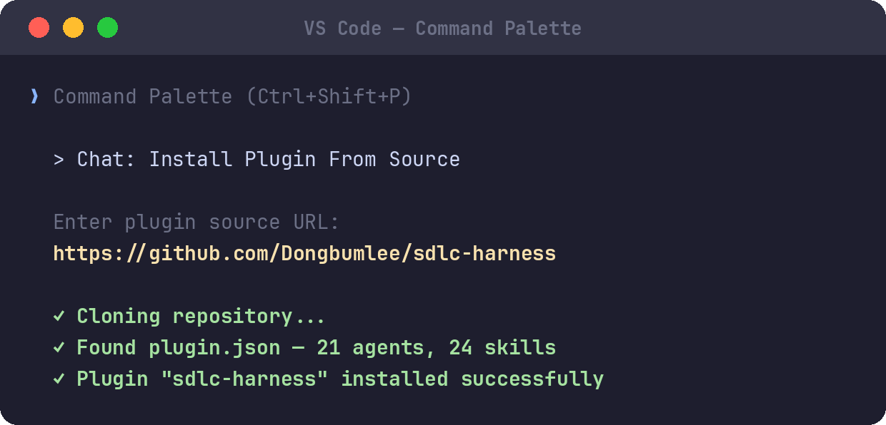
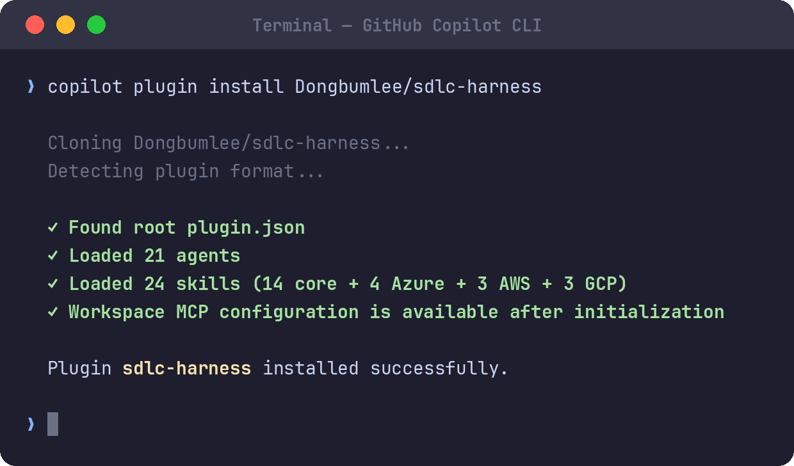
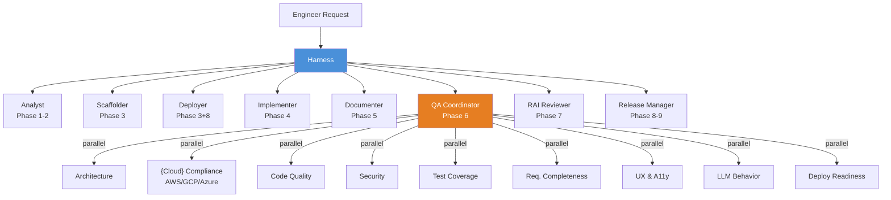
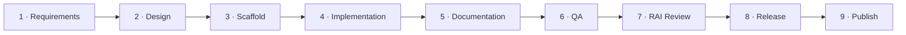

# SDLC Harness

[](LICENSE)
[](https://github.com/Dongbumlee/sdlc-harness)
[](https://code.visualstudio.com/)
[](https://docs.github.com/en/copilot/how-tos/copilot-cli)
[](https://github.com/Dongbumlee/sdlc-harness/releases/tag/v1.3.0)
[](#supported-stacks)

> *From first commit to final release, Harness orchestrates your entire software development
> lifecycle — so you can focus on building what matters.*

**SDLC Harness** is a multi-agent orchestration system for GitHub Copilot that drives
software projects through 9 SDLC phases using 21 specialized AI agents. It combines
adversarial QA evaluation, live MCP-powered context, and iterative feedback loops to
deliver production-quality code with enforced development standards.

Distributed as an [Agent Plugin](#quick-start) for VS Code and GitHub Copilot CLI.
Install once — get all 21 agents, 24 skills, and the full SDLC workflow instantly.

### Why it holds up

- **Consistency over cleverness** — the same standards apply across
  [6 stacks](#supported-stacks), any engineer, and any model seat. Patterns are
  recorded in the project's manifest and enforced by gates, not remembered by
  a session.
- **Ceremony sized to the task** — every run is graded Small / Medium / Large.
  Small work takes a consolidated fast path through design; large work gets
  the full review panel and more convergence rounds.
- **Evidence, not claims** — a phase is Complete only when its exit gate has
  checked the artifacts on disk. Even the spec's version claims are compared
  mechanically against the bundled templates before design is approved.

---

## Table of Contents

- [Quick Start](#quick-start)
- [Architecture](#architecture)
- [Supported Stacks](#supported-stacks)
- [How It Works](#how-it-works)
- [Cloud Packs](#cloud-packs)
- [Canary Testing](#canary-testing)
- [What's Included](#whats-included)
- [Documentation](#documentation)
- [Prerequisites](#prerequisites)
- [Adopting in Your Repo](#adopting-in-your-repo)
- [Contributing](#contributing)

---

## Quick Start

### Install the plugin

**VS Code**



**GitHub Copilot CLI**



### First use

> [!CAUTION]
> **Two VS Code settings are required:**
>
> | Setting | Value | Why |
> |---------|-------|-----|
> | `chat.agent.defaultApproval` | `autopilot` | Without this, every tool call requires manual approval. |
> | `github.copilot.chat.virtualTools.threshold` | `0` | Harness uses 7 MCP servers (~150+ tools). The default limit hides tools. |

Open your project and bootstrap:

```
# Recommended: explicit invocation
/sdlc-harness
initialize workspace
```

Or via the agent picker:

```
/agent harness
initialize workspace
```

Harness deploys MCP config, quality instructions, and prompt files, then asks for your
project details (name, domain, stack) to generate `copilot-instructions.md`.

> After Harness deploys `.vscode/mcp.json`, start the MCP servers and **open a new chat
> session** (`Ctrl+L`) — VS Code registers MCP tools at session start.

The repository includes the agent profiles in both supported locations:

- `.github/agents/` — Copilot CLI, GitHub Copilot App, and repository-level discovery.
- `com.github.copilot/agents/` — Agent Plugins-compatible package layout.

The two directories must remain identical. In Copilot CLI, use `/agent` and select
`harness`; `@` is reserved for file references.

---

## Architecture

### Agent system (21 agents)

A single user-facing agent — **Harness** — orchestrates specialized workers,
each scoped to a specific SDLC phase with least-privilege tool access.



| Role | Agents | Phase |
|------|--------|-------|
| **Orchestrator** | Harness | Routes all work |
| **Phase workers** | Analyst, Scaffolder, Deployer, Implementer, Documenter, QA Coordinator, RAI Reviewer, Release Manager | 1–9 |
| **QA reviewers** (9 domains) | Architecture, Cloud Compliance (Azure / AWS / GCP — one runs, matching the project's cloud), Code Quality, Security, Test Coverage, Requirements Completeness, UX/A11y, LLM Behavior, Deployment Readiness | Phase 6 |
| **Azure pack extra** | QA Bug Checklist Reviewer (338 production bug patterns; user-invocable, not a panel member) | Cross-cutting |

### 9-phase SDLC workflow

| Phase | Name | Agent |
|-------|------|-------|
| 1 | Requirement Analysis | Analyst |
| 2 | Design | Analyst |
| 3 | Repo Structure & CI/CD | Scaffolder |
| 4 | Implementation & Tests | Implementer |
| 5 | Documentation | Documenter |
| 6 | QA Activities | QA Coordinator → 9 reviewers |
| 7 | Responsible AI Review | RAI Reviewer |
| 8 | Release Preparation | Release Manager |
| 9 | Publish | Release Manager |



Phase 0 (workspace init) runs once before a project's first run, and Phase 3B
is an infrastructure-validation checkpoint inside the deploy path — neither
inflates the 9-phase count. Every phase exit is a gate: the Harness checks
the artifacts on disk, and the phase's row in the manifest ledger moves to
Complete only when the gate passes.

### QA evaluation engine

Inspired by [Anthropic's harness design research](https://www.anthropic.com/engineering/harness-design-long-running-apps):

- **Generator-evaluator separation** — 9 independent reviewers run in parallel, each in its own context window with no anchoring bias.
- **Adversarial posture** — every reviewer has explicit anti-leniency instructions.
- **Numeric scoring** — each reviewer scores 1-10. Security requires ≥8, others ≥7. Any Critical finding = automatic fail.
- **Iterative loops** — QA → fix → delta re-review of the changed ranges only. Round caps scale with the task grade (Small 2, Medium 3, Large 3 in Phase 6).
- **Weighted composite** — `(security × 1.5 + sum of other active domains) / (1.5 + active domains)`. Composite < 7 = fail.

See [docs/harness-design.md](docs/harness-design.md) for the full research-to-implementation mapping.

### MCP integration (7 servers)

Agents fetch live context from external tools — no stale training data:

| Server | Purpose | Used by |
|--------|---------|---------|
| **GitHub MCP** | SDK patterns, reference repos, code search | Implementer, Scaffolder, Analyst |
| **Awesome-Copilot** | OWASP Top 10, Bicep best practices, Python standards | Security Reviewer, Deployer |
| **Azure MCP** | Validate Azure resources, manage subscriptions | Deployer, Azure Compliance Reviewer |
| **Azure DevOps MCP** | ADO wikis, pipelines, work items | QA Coordinator, Deployer |
| **Microsoft Learn MCP** | AVM module docs, Azure service documentation | Deployer, Documenter |
| **Context7** | Current framework docs (FastAPI, React, etc.) | Implementer, Analyst |
| **Playwright** | Browser automation for E2E testing | QA Coordinator |

> **Setup:** Run `tools/check-mcp.ps1` (Windows) or `tools/check-mcp.sh` (Linux/macOS)
> to auto-configure MCP servers for VSCode, Copilot CLI, Claude Code, and Claude Desktop.
> See [MCP Troubleshooting](docs/mcp-troubleshooting.md) for common issues.

---

## Supported Stacks

A stack is supported when it ships all four of: a stack profile (pinned
values and rules), a language instruction pair, a bundled project template,
and a verified greenfield run of that template. Six stacks qualify:

| Stack | Bundled default | Template stack |
|-------|-----------------|----------------|
| **Python** | FastAPI API | FastAPI + pytest, layered web/service/data layout |
| **.NET** | ASP.NET Core API | .NET 10 (`net10.0`), xUnit + coverlet |
| **TypeScript** | Web app | Next.js ≥ 16.2.11 on TypeScript 6 (held at 6.x — typescript-eslint does not support TS 7 yet) |
| **Java** | Spring Boot API | Java 21 LTS, Spring Boot 3.5, Maven wrapper, JUnit + JaCoCo |
| **Go** | HTTP API | Go 1.27, standard library `net/http` only — no web framework |
| **Rust** | HTTP API | Rust edition 2024, axum, one crate with layered modules |

Scaffolding copies the bundled template verbatim (org templates override
when configured). The Phase 1–2 design gate mechanically checks the spec's
stack claims against the template it will actually be built from.

---

## How It Works

```
/agent harness
Implement the order history API from ADR-012.
```

1. **Harness** identifies this as Phase 4, verifies the ADR exists, delegates to **Implementer**.
2. **Implementer** fetches live SDK patterns (GitHub MCP), loads framework docs (Context7), writes code + tests.
3. **QA Coordinator** spawns 9 reviewers in parallel — each scores 1-10 with adversarial posture.
4. If any domain fails its threshold, Harness runs an **iterative fix loop** — fix, then a delta re-review of the changed ranges, within the grade's round cap.
5. **Documenter** updates the ADR. **Release Manager** creates the PR.

Engineers stay in control — agents propose, engineers decide. Every subagent call is
visible in Chat as a collapsible tool call.

### Sized to the task

Every run is graded at intake and fixed at design — **Small** (≤10 user-facing
operations, one component), **Medium**, or **Large** (multiple components,
integrations, or strong complexity signals) — and the grade sets the ceremony:

- **Small** — Phases 1–2 consolidate: one Analyst session per phase (the
  Phase 2 session also saves the ADR) and one combined requirements +
  architecture exit review. Phase-exit reviews use the primary reviewer;
  Phase 6 keeps its always-active panel.
- **Medium** — the standard ceremony described in this README.
- **Large** — full reviewer panel at phase exits and the highest round caps.

Grades only move up freely; a downgrade requires the engineer's approval.
The canonical definitions — phases, gates, severities, round caps — live in
[docs/base-definitions.md](docs/base-definitions.md).

See [docs/workflow-guide.md](docs/workflow-guide.md) for the full step-by-step walkthrough with sequence diagrams.

---

## Cloud Packs

Cloud Packs are modular skill sets for specific cloud platforms. Each pack adds
deployment, data access, and storage skills tailored to that provider.

| Pack | Skills | Status |
|------|--------|--------|
| **Azure** | `sdlc-azure-deployment`, `sdlc-cosmos-repository`, `sdlc-blob-storage` | Included |
| **AWS** | `sdlc-aws-deployment`, `sdlc-dynamodb-repository`, `sdlc-s3-storage` | Included |
| **GCP** | `sdlc-gcp-deployment`, `sdlc-firestore-repository`, `sdlc-gcs-storage` | Included |

Each pack's metadata lives at `packs/<cloud>/pack.json`; skills are also
published in the root `skills/` directory so current Agent Plugins clients discover them.
The root `skills/`, `com.github.copilot/agents/` and `.github/agents/` directories are
generated from `packs/*/` by `tools/assemble_flat_layout.py` — edit the pack source,
not the flat layout.
To create a new cloud pack, use the `packs/_template/` skeleton.

---

## Canary Testing

SDLC Harness includes an E2E test framework for validating the harness itself.
Canary specs define expected agent behavior for each SDLC phase, including
separate release-preparation (Phase 8) and publish (Phase 9) checks.

- **30 canary specs** across `bench/canaries/` (phase coverage + catalog + QA gate and negative-path tests)
- **2 JSON schemas** in `schemas/` for validation (canary specs, cloud packs)
- **CI integration** — `canary-test.yml` validates spec schema on PRs touching agents/skills
- Results stored as structured JSON in `bench/results/`

```bash
# Validate canary specs locally
python tools/validate_canaries.py
```

---

## What's Included

### Agents (21)

| Agent | Description |
|-------|-------------|
| **Harness** | Orchestrator — routes all SDLC work |
| **Analyst** | Phase 1-2: Requirements & design |
| **Scaffolder** | Phase 3: Repo structure from templates |
| **Deployer** | Phase 3+8: Azure infrastructure (Bicep/AVM) |
| **Implementer** | Phase 4: Production code + tests |
| **Documenter** | Phase 5: ADRs, API docs |
| **QA Coordinator** | Phase 6: Dispatches 9 parallel reviewers |
| **RAI Reviewer** | Phase 7: Responsible AI assessment |
| **Release Manager** | Phase 8-9: Changelog, PR, publish |
| **Architecture Reviewer** | QA: Layering, dependency boundaries |
| **Azure Compliance Reviewer** | QA: SDK usage, AVM, identity (Azure pack) |
| **AWS Compliance Reviewer** | QA: SDK usage, CDK, identity (AWS pack) |
| **GCP Compliance Reviewer** | QA: SDK usage, Terraform, identity (GCP pack) |
| **Code Quality Reviewer** | QA: Naming, docstrings, dead code |
| **Security Reviewer** | QA: OWASP, secrets, auth |
| **Test Coverage Reviewer** | QA: Tests, coverage, assertions |
| **Requirements Completeness Reviewer** | QA: All requirements addressed |
| **UX & Accessibility Reviewer** | QA: ARIA, keyboard nav, a11y |
| **LLM Behavior Reviewer** | QA: Prompt safety, grounding, citations |
| **Deployment Readiness Reviewer** | QA: Error handling, perf, observability |
| **QA Bug Checklist Reviewer** | Azure pack: 338 real bug patterns (user-invocable) |

### Skills (24)

| Skill | Purpose |
|-------|---------|
| `sdlc-harness` | Entry point: routes a request into the SDLC workflow |
| `sdlc-workspace-init` | Bootstrap workspace (MCP config, instructions, prompts) |
| `sdlc-stack-profiles` | Per-stack pinned values, bundled templates, mechanical stack-conformance check |
| `sdlc-project-scaffolding` | Scaffold projects from templates |
| `sdlc-project-manifest` | Cross-agent consistency manifest |
| `sdlc-reference-catalog` | Living catalog of approved libraries |
| `sdlc-adr-authoring` | Architecture Decision Records |
| `sdlc-requirements-discovery` | Requirements elicitation |
| `sdlc-architecture-review` | Architecture review checklist |
| `sdlc-code-quality` | Code quality review checklist |
| `sdlc-security-review` | OWASP + Azure security patterns |
| `sdlc-project-qa` | Comprehensive product QA checklist |
| `sdlc-qa-bug-checklist` | Azure Pack: 338 real production bug patterns |
| `sdlc-reviewer-output-format` | Structured YAML output for reviewers |
| `sdlc-canary-runner` | E2E canary test runner |
| `sdlc-azure-deployment` | Azure Pack: Bicep/AVM deployment |
| `sdlc-cosmos-repository` | Azure Pack: Cosmos DB Repository Pattern |
| `sdlc-blob-storage` | Azure Pack: Blob Storage + Queue operations |
| `sdlc-aws-deployment` | AWS Pack: CDK deployment (Lambda container + Fargate Spot) |
| `sdlc-dynamodb-repository` | AWS Pack: DynamoDB Repository Pattern |
| `sdlc-s3-storage` | AWS Pack: S3 + presigned URL operations |
| `sdlc-gcp-deployment` | GCP Pack: Terraform deployment (Cloud Run + Jobs) |
| `sdlc-firestore-repository` | GCP Pack: Firestore Repository Pattern |
| `sdlc-gcs-storage` | GCP Pack: Cloud Storage + signed URL operations |

### Quality instructions (14 files, auto-applied by file type)

| Language | Code quality | Test quality |
|----------|-------------|-------------|
| Python | `code-quality-py` | `test-quality` |
| TypeScript | `code-quality-ts` | `test-quality-ts` |
| React/TSX | `code-quality-tsx` | `test-quality-tsx` |
| C# | `code-quality-csharp` | `test-quality-csharp` |
| Java | `code-quality-java` | `test-quality-java` |
| Go | `code-quality-go` | `test-quality-go` |
| Rust | `code-quality-rust` | `test-quality-rust` |

### Prompt files (6)

| Prompt | Phase | Routes to |
|--------|-------|-----------|
| `requirement-and-design` | 1-2 | Analyst |
| `repo-structure-and-cicd` | 3 | Scaffolder |
| `deployment` | 3+8 | Deployer |
| `implementation-and-tests` | 4 | Implementer |
| `repo-documentation` | 5 | Documenter |
| `qa-rai-release` | 6-8 | Harness |

---

## Documentation

| Document | What it covers |
|----------|---------------|
| [Base Definitions](docs/base-definitions.md) | The canonical standard: phases, gates, severities, round caps, records — where a pack file and this document disagree, this document wins |
| [Harness Design](docs/harness-design.md) | Why the QA system is built this way (generator–evaluator research → implementation) |
| [Workflow Guide](docs/workflow-guide.md) | Step-by-step: how engineers and agents work together, with a sequence diagram |
| [Orchestrator States](docs/orchestrator-states.md) | The Harness state model: dispatch, validation, fix loops, QA gate, blocked states |
| [Agent Inventory](docs/agent-inventory.md) | Generated inventory of all 21 agents and 24 skills |
| [MCP Troubleshooting](docs/mcp-troubleshooting.md) | MCP server setup issues and fixes |
| [ADR-0001](docs/adr/ADR-0001-pack-separation.md) · [ADR-0002](docs/adr/ADR-0002-bundled-default-templates.md) · [ADR-0003](docs/adr/ADR-0003-github-native-operations.md) | Pack separation · bundled default templates · GitHub-native operations |

---

## Prerequisites

| Tool | Version | Purpose |
|------|---------|---------|
| **VS Code** | latest | Primary IDE |
| **GitHub Copilot** + **Copilot Chat** | latest | Required extensions |
| **Git** | 2.40+ | Version control |
| **Docker** | latest | Container builds, MCP servers |
| **Python** | 3.12+ | The harness's own tooling, template verification, and tests |

Per-stack toolchains are needed only for projects on that stack:
**.NET SDK 10** (dotnet), **JDK 21 + Maven** (java), **Go 1.27** (go),
**Rust** via rustup (rust), **Node.js 20+ / pnpm** (typescript),
**uv** (python). For Azure Pack projects add **Azure CLI**,
**Azure Developer CLI** 1.18.2+ (`azd up`), and the **Bicep CLI**.

---

## Adopting in Your Repo

### Option A: Plugin install (recommended)

```bash
# Register the marketplace once
copilot plugin marketplace add Dongbumlee/sdlc-harness

# Install or update the plugin from the marketplace
copilot plugin install sdlc-harness@sdlc-harness
```

Then open any project and run:

```
/agent harness
initialize workspace
```

Harness generates `copilot-instructions.md`, deploys quality instructions and prompt files.

To update the plugin later:

```bash
copilot plugin marketplace update sdlc-harness
copilot plugin install sdlc-harness@sdlc-harness
```

`copilot plugin install Dongbumlee/sdlc-harness` still works today, but Copilot CLI
marks direct repository installs as deprecated. Use the marketplace form to remain
compatible with future CLI releases.

### Option B: Manual copy

1. Copy `.github/agents/`, `skills/`, `.github/prompts/`, `.github/instructions/`, `.design/`, `.vscode/mcp.json`
2. Set `<PROJECT_NAME>` in `.github/copilot-instructions.md`
3. Select quality instruction files matching your stack

### Adoption checklist

- [ ] Install plugin or copy files
- [ ] Run `/agent harness` or `/sdlc-workspace-init` to generate workspace files
- [ ] Review `.github/copilot-instructions.md`
- [ ] Start MCP servers, open new chat session
- [ ] Enable branch protection on `main`

---

## Contributing

SDLC Harness development happens on `main`, through pull requests. Every
change runs the verification battery locally before it is proposed:
`tools/assemble_flat_layout.py --check`, `tools/verify_templates.py`,
`tools/check_pack_contracts.py`, `tools/generate_agent_inventory.py --check`,
and `python3 -m pytest tests/ -q`.

### Repository structure

```
packs/                ← Source of truth: core pack + Azure/AWS/GCP cloud packs
  core/                 agents, skills, prompts, instructions, MCP config
  azure/ aws/ gcp/      cloud-specific agents and skills
.github/agents/       ← Generated mirrors of packs/*/agents (do not edit)
com.github.copilot/   ← Generated mirrors for the Agent Plugins layout
skills/               ← Generated mirrors of packs/*/skills (do not edit)
plugin.json           ← Root plugin manifest
.claude-plugin/       ← Marketplace metadata
bench/canaries/       ← E2E canary test specs
schemas/              ← JSON schemas for validation
tests/                ← Repository test suite (pytest)
tools/                ← Assembly, verification, and inventory scripts
docs/                 ← Architecture docs, specs, guides
```

The flat layout (`.github/`, `com.github.copilot/`, `skills/`) is generated
from `packs/` by `tools/assemble_flat_layout.py` — edit the pack source and
regenerate, never the mirrors.

### CI checks

| Workflow | Purpose |
|----------|---------|
| `pack-assembly.yml` | Fails when the generated flat layout drifts from `packs/` |
| `pack-contracts.yml` | Validates pack metadata and cross-pack contracts |
| `python-tests.yml` | Runs the repository test suite |
| `canary-test.yml` | Validates canary spec schema on PRs touching agents/skills |
| `bump-plugin-version.yml` | Manually bumps the plugin version and synchronizes marketplace metadata |

Releases are cut from `main` with a written scope freeze (IN/OUT) recorded
before the tag. A version bump covers the full surface — `plugin.json`,
`.claude-plugin/marketplace.json`, all four `packs/*/pack.json` files, and
the tests that pin the version; the Bump Plugin Version workflow updates
only the first two, so a release bump is completed by hand.

### Key rules

- VSIX distribution is retired — do not recreate `vscode-extension/`, `sync-check.yml`, or `build-vsix.yml`. The repo ships as a root Agent Plugins package via `plugin.json`, `skills/`, and `com.github.copilot/`, with `.claude-plugin/marketplace.json` providing marketplace metadata.
- Agent/skill changes require corresponding canary spec updates
- All QA reviewers emit structured YAML output (see `sdlc-reviewer-output-format` skill)

---

## License

MIT
