<p align="center">
  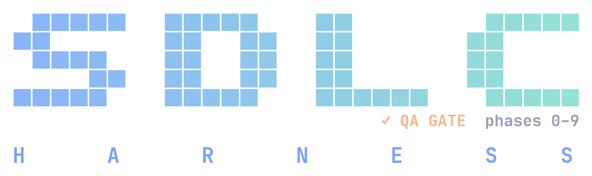
</p>

# SDLC Harness

[](LICENSE)
[](https://github.com/Dongbumlee/sdlc-harness)
[](https://code.visualstudio.com/)
[](https://docs.github.com/en/copilot/how-tos/copilot-cli)
[](https://github.com/Dongbumlee/sdlc-harness/releases/tag/v1.3.4)
[](#supported-stacks)

> *From first commit to final release, Harness orchestrates your entire software development
> lifecycle — so you can focus on building what matters.*

**SDLC Harness** is a multi-agent orchestration system that drives
software projects through 9 SDLC phases using 22 specialized AI agents.
It runs on GitHub Copilot (VS Code and Copilot CLI) and on Claude Code,
generated from the same pack sources for both hosts. It combines
adversarial QA evaluation, live MCP-powered context, and iterative feedback loops to
deliver production-quality code with enforced development standards.

Distributed as an [Agent Plugin](#quick-start) for both hosts.
Install once — get all 22 agents, 25 skills, and the full SDLC workflow instantly.

### Why it holds up

- **Consistency over cleverness** — the same standards apply across
  [6 stacks](#supported-stacks), any engineer, and any model seat. Patterns are
  recorded in the project's manifest and enforced by gates, not remembered by
  a session.
- **Ceremony sized to the task** — every run is graded Small / Medium / Large.
  Small work takes a consolidated fast path through design; large work gets
  the full review panel and more convergence rounds.
- **Evidence, not claims** — a phase is Complete only when its exit gate has
  checked the artifacts on disk. Even the spec's version claims are compared
  mechanically against the bundled templates before design is approved.

---

## Table of Contents

- [Quick Start](#quick-start)
- [How It Works](#how-it-works)
- [Architecture](#architecture)
- [Supported Stacks](#supported-stacks)
- [Cloud Packs](#cloud-packs)
- [What's in the Box](#whats-in-the-box)
- [Documentation](#documentation)
- [Prerequisites](#prerequisites)
- [Adopting in Your Repo](#adopting-in-your-repo)
- [Contributing](#contributing)

---

## Quick Start

### Install the plugin

**VS Code**

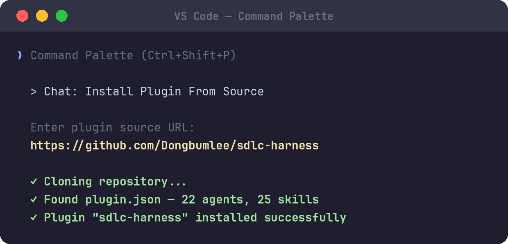

**GitHub Copilot CLI**

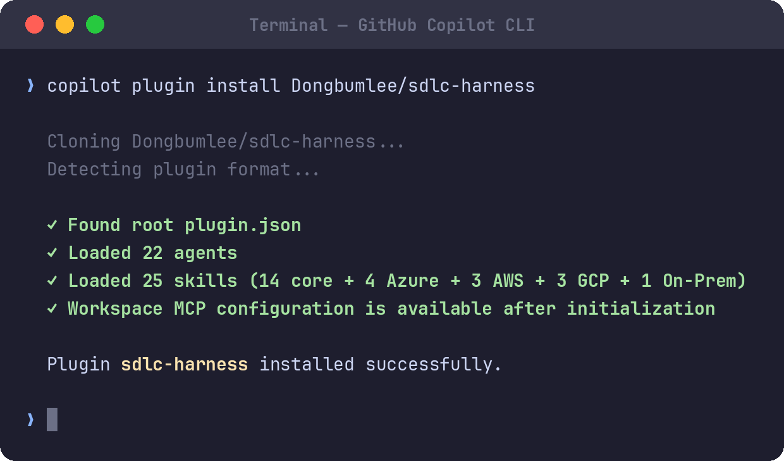

**Claude Code**

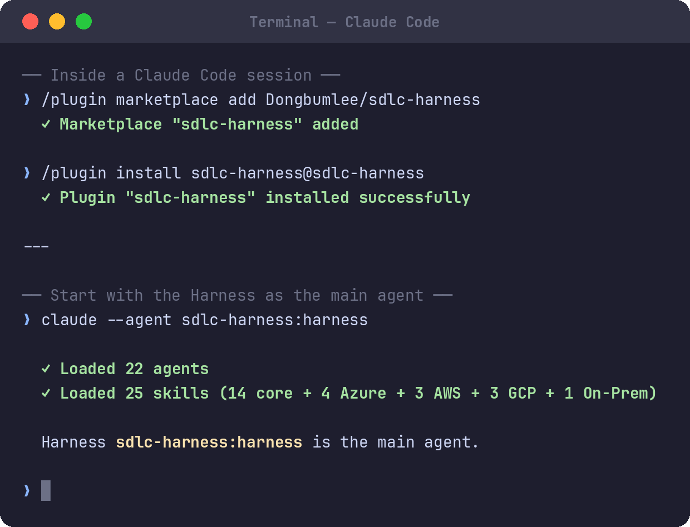

The Claude Code plugin is generated from the same pack sources as the Copilot
one — see [Host support](docs/host-support.md) for the support matrix and the
differences that apply on Claude Code.

### First use

Open your project, start the Harness on your host, and say
**initialize workspace**. The Harness asks for your project details
(name, domain, stack), generates `copilot-instructions.md`, and deploys
the MCP configuration, quality instructions, and prompt files your host
uses. How you start the Harness depends on the host:

**VS Code**

> **Two settings first:** `chat.agent.defaultApproval` set to `autopilot`
> (otherwise every tool call asks for manual approval) and
> `github.copilot.chat.virtualTools.threshold` set to `0` (the default
> limit hides MCP tools). [Troubleshooting](docs/troubleshooting.md)
> covers both, and what to do when they are missing.

```
# Recommended: explicit invocation
/sdlc-harness
initialize workspace
```

Or via the agent picker: `/agent harness`, then `initialize workspace`.

> After Harness deploys `.vscode/mcp.json`, start the MCP servers and **open a new chat
> session** (`Ctrl+L`) — VS Code registers MCP tools at session start.

**Copilot CLI**

Use `/agent` and select `harness` (`@` is reserved for file references),
then say `initialize workspace`.

**Claude Code**

Start with the Harness as the main agent, then say `initialize workspace`:

```bash
claude --agent sdlc-harness:harness
```

### Your first run

Start small: [Your First Run](docs/first-run.md) walks one small,
local job — a Python CLI — through the design conversation, the
build, and the QA panel, in about five minutes of reading. No cloud
account needed.

---

## How It Works

You say what to build, approve the plan, and make the final call on shipping.
One coordinator plans the work, hands each step to a specialist, and checks
every result against the actual files. Six patterns hold the system together —
the map shows where each one sits, and the patterns below it are numbered to
match.

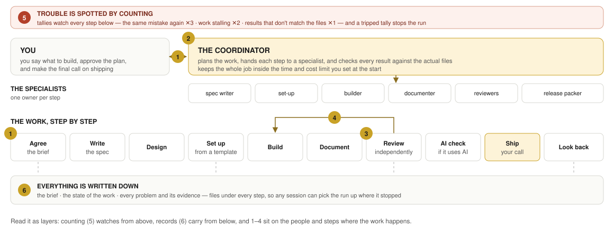

### The six patterns

#### 1 · Agree first, build second

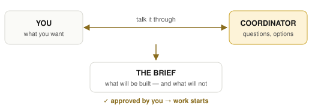

Before anything is built, the job is talked through and written down: what
will be built, what will not, and the limits. Nothing starts until you approve
that brief.

#### 2 · One coordinator, many specialists

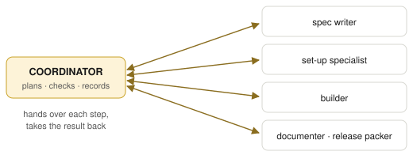

The coordinator does none of the work itself. Each step goes to a specialist,
and what comes back is checked against the actual files before anything moves
on.

#### 3 · Builders never grade their own work

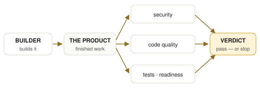

The finished work is checked by reviewers who took no part in building it —
several angles at once, plus a checklist of 338 known problem patterns. One
serious problem stops the release.

#### 4 · Fix it, then check again

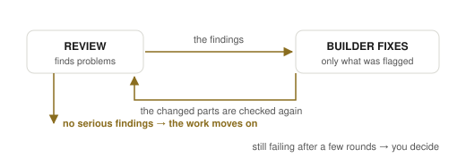

Problems found in review go back to the builder. Only the changed parts are
re-checked, not the whole job — and a retry has to change something, never
repeat the same attempt. If it still fails after a few rounds, the decision is
yours.

#### 5 · Trouble is spotted by counting

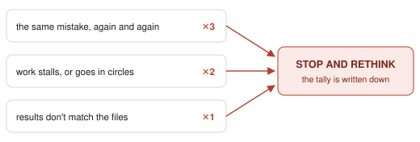

Warning signs are counted as the work goes: the same mistake repeating, work
that stalls, results that don't match the files. When a count trips, the run
stops and rethinks instead of pushing on. Feelings don't trigger stops —
tallies do.

#### 6 · Everything is written down

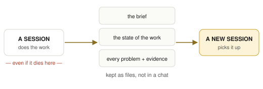

The brief, the state of the work, every problem and its evidence live in
files. If a session crashes or is closed, the next one resumes from the
record — proven in practice on 2026-11-14, when a second session picked up a
stopped run and finished it.

**Built on proven parts.** The same playbooks, standards and templates on
every job — a new project starts from a tested shape, not a blank page. Tools
for documentation, code hosting and testing plug in. And it runs on more than
one AI assistant, with your choice of model — no lock-in.

### A run, in practice

On Copilot, you address the Harness through the agent picker; on Claude
Code it is already your main agent. Either way, a request looks like this:

```
/agent harness
Implement the order history API from ADR-012.
```

1. **Harness** identifies this as Phase 4, verifies the ADR exists, delegates to **Implementer**.
2. **Implementer** fetches live SDK patterns (GitHub MCP), loads framework docs (Context7), writes code + tests.
3. **QA Coordinator** spawns 9 reviewers in parallel — each scores 1-10 with adversarial posture.
4. If any domain fails its threshold, Harness runs an **iterative fix loop** — fix, then a delta re-review of the changed ranges, within the grade's round cap.
5. **Documenter** updates the ADR. **Release Manager** creates the PR.

Engineers stay in control — agents propose, engineers decide. Every subagent call is
visible in the session as a collapsible tool call.

<p align="center">
  <picture>
    <source media="(prefers-color-scheme: dark)" srcset="docs/assets/harness-run-dark.gif">
    <source media="(prefers-color-scheme: light)" srcset="docs/assets/harness-run-light.gif">
    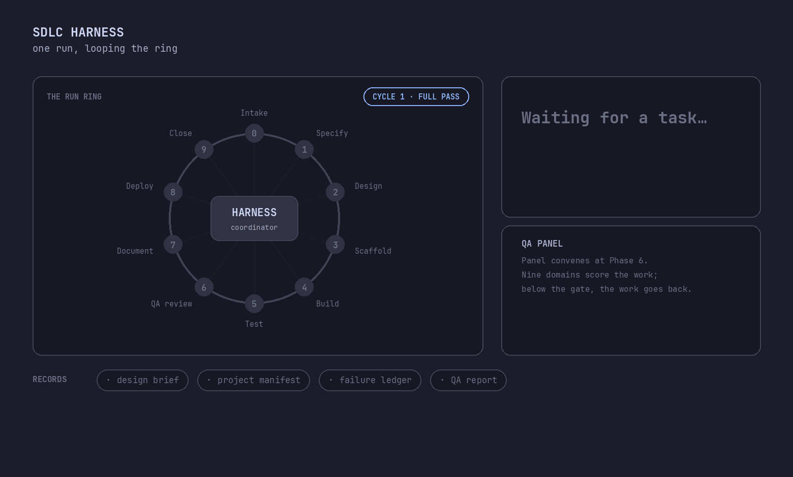
  </picture>
</p>

### Sized to the task

Every run is graded at intake and fixed at design — **Small** (≤10 user-facing
operations, one component), **Medium**, or **Large** (multiple components,
integrations, or strong complexity signals) — and the grade sets both the
ceremony and the run's budget envelope:

| Grade | Spend cap | Active-time cap |
|-------|-----------|-----------------|
| Small | ≤ $20 | ≤ 4 hours |
| Medium | ≤ $75 | ≤ 2 days |
| Large | ≤ $250 | ≤ 5 days |

The envelope is a cap the run is held to, not an estimate: how long a
run actually takes depends on the model seat it runs on — the same
Small job finishes quickly on a fast seat and takes much longer on a
slow one.

- **Small** — Phases 1–2 consolidate: one Analyst session per phase (the
  Phase 2 session also saves the ADR) and one combined requirements +
  architecture exit review. Phase-exit reviews use the primary reviewer;
  Phase 6 keeps its always-active panel.
- **Medium** — the standard ceremony described in this README.
- **Large** — full reviewer panel at phase exits and the highest round caps.

Grades only move up freely; a downgrade requires the engineer's approval.
The canonical definitions — phases, gates, severities, round caps — live in
[docs/base-definitions.md](docs/base-definitions.md).

See [docs/workflow-guide.md](docs/workflow-guide.md) for the full step-by-step walkthrough with sequence diagrams.

---

## Architecture

### Agent system (22 agents)

A single user-facing agent — **Harness** — orchestrates specialized workers,
each scoped to a specific SDLC phase with least-privilege tool access.

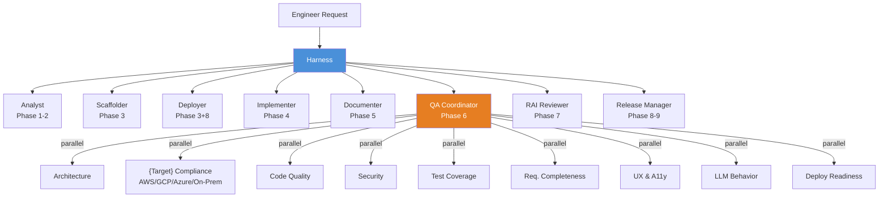

| Role | Agents | Phase |
|------|--------|-------|
| **Orchestrator** | Harness | Routes all work |
| **Phase workers** | Analyst, Scaffolder, Deployer, Implementer, Documenter, QA Coordinator, RAI Reviewer, Release Manager | 1–9 |
| **QA reviewers** (9 domains) | Architecture, Target Compliance (Azure / AWS / GCP / On-Prem — one runs, matching the project's deployment target), Code Quality, Security, Test Coverage, Requirements Completeness, UX/A11y, LLM Behavior, Deployment Readiness | Phase 6 |
| **Azure pack extra** | QA Bug Checklist Reviewer (338 production bug patterns; user-invocable, not a panel member) | Cross-cutting |

### 9-phase SDLC workflow

| Phase | Name | Agent |
|-------|------|-------|
| 1 | Requirement Analysis | Analyst |
| 2 | Design | Analyst |
| 3 | Repo Structure & CI/CD | Scaffolder |
| 4 | Implementation & Tests | Implementer |
| 5 | Documentation | Documenter |
| 6 | QA Activities | QA Coordinator → 9 reviewers |
| 7 | Responsible AI Review | RAI Reviewer |
| 8 | Release Preparation | Release Manager |
| 9 | Publish | Release Manager |

Phase 0 (workspace init) runs once before a project's first run, and Phase 3B
is an infrastructure-validation checkpoint inside the deploy path — neither
inflates the 9-phase count. Every phase exit is a gate: the Harness checks
the artifacts on disk, and the phase's row in the manifest ledger moves to
Complete only when the gate passes.

### QA evaluation engine

Inspired by [Anthropic's harness design research](https://www.anthropic.com/engineering/harness-design-long-running-apps):

- **Generator-evaluator separation** — 9 independent reviewers run in parallel, each in its own context window with no anchoring bias.
- **Adversarial posture** — every reviewer has explicit anti-leniency instructions.
- **Numeric scoring** — each reviewer scores 1-10. Security requires ≥8, others ≥7. Any Critical finding = automatic fail.
- **Iterative loops** — QA → fix → delta re-review of the changed ranges only. Round caps scale with the task grade (Small 2, Medium 3, Large 3 in Phase 6).
- **Weighted composite** — `(security × 1.5 + sum of other active domains) / (1.5 + active domains)`. Composite < 7 = fail.

See [docs/harness-design.md](docs/harness-design.md) for the full research-to-implementation mapping.

### MCP integration

Agents fetch live context from external tools — no stale training data.
Three servers are core to every workspace; each cloud pack adds its
vendor's servers:

| Server | Purpose |
|--------|---------|
| **GitHub MCP** | SDK patterns, reference repos, code search; also fetches best-practice instructions and collections (OWASP Top 10, Bicep best practices, Python standards) from the `github/awesome-copilot` repository — a discovery-time source, not a configured server |
| **Context7** | Current framework docs (FastAPI, React, etc.) |
| **Playwright** | Browser automation for E2E testing |
| **Azure MCP Server** | Validate Azure resources, manage subscriptions (Azure pack) |
| **Microsoft Learn MCP** | AVM module docs, Azure service documentation (Azure pack) |
| **AWS MCP Server** | The one managed AWS MCP Server, via the pinned MCP Proxy for AWS (AWS pack) |
| **Google Developer Knowledge MCP** | Google Cloud documentation (GCP pack) |
| **Firestore MCP** | Firestore managed endpoint (GCP pack) |

GitHub is the only forge — there is no Azure DevOps (or other tracker)
server.

> **Setup:** Working from a clone of this repository? Run `tools/check-mcp.ps1`
> (Windows) or `tools/check-mcp.sh` (Linux/macOS) to auto-configure MCP servers
> for VS Code, Copilot CLI, and Claude Code.
> See [Troubleshooting](docs/troubleshooting.md#mcp-servers) for common issues.

---

## Supported Stacks

A stack is supported when it ships all four of: a stack profile (pinned
values and rules), a language instruction pair, a bundled project template,
and a verified greenfield run of that template. Six stacks qualify:

| Stack | Bundled default | Template stack |
|-------|-----------------|----------------|
| **Python** | FastAPI API | FastAPI + pytest, layered web/service/data layout |
| **.NET** | ASP.NET Core API | .NET 10 (`net10.0`), xUnit + coverlet |
| **TypeScript** | Web app | Next.js ≥ 16.2.11 on TypeScript 6 (held at 6.x — typescript-eslint does not support TS 7 yet) |
| **Java** | Spring Boot API | Java 21 LTS, Spring Boot 3.5, Maven wrapper, JUnit + JaCoCo |
| **Go** | HTTP API | Go 1.27, standard library `net/http` only — no web framework |
| **Rust** | HTTP API | Rust edition 2024, axum, one crate with layered modules |

Scaffolding copies the bundled template verbatim (org templates override
when configured). The Phase 1–2 design gate mechanically checks the spec's
stack claims against the template it will actually be built from.

---

## Cloud Packs

Cloud Packs are modular skill sets for specific platforms. Each pack adds
deployment, data access, and storage skills tailored to that target.

| Pack | Skills | Status |
|------|--------|--------|
| **Azure** | `sdlc-azure-deployment`, `sdlc-cosmos-repository`, `sdlc-blob-storage` | Included |
| **AWS** | `sdlc-aws-deployment`, `sdlc-dynamodb-repository`, `sdlc-s3-storage` | Included |
| **GCP** | `sdlc-gcp-deployment`, `sdlc-firestore-repository`, `sdlc-gcs-storage` | Included |
| **On-Premises** | `sdlc-onprem-deployment` | Included |

Skills are also published in the root `skills/` directory so current Agent
Plugins clients discover them. Pack layout and authoring a new pack
(the `packs/_template/` skeleton) are covered under [Contributing](#contributing).

---

## What's in the Box

- **22 agents** — the Harness orchestrator, 8 phase workers, 9 QA reviewer
  domains (with one target-compliance reviewer per cloud pack), and the
  standalone QA Bug Checklist Reviewer carrying 338 real production bug
  patterns (Azure pack).
- **25 skills** — the workflow itself: workspace init, stack profiles,
  scaffolding, the project manifest, requirements discovery, ADR authoring,
  the review checklists, and one deployment + data pair per cloud pack.
- **30 bundled templates** across 6 stacks and 6 project types, copied
  verbatim at scaffolding.
- **14 quality instruction files** (code + test standards for 7 languages),
  **6 prompt files**, and the MCP configuration for 3 core servers plus
  your cloud pack's vendor servers.

The full generated list — every agent and skill with its file — lives in
[docs/agent-inventory.md](docs/agent-inventory.md).

---

## Documentation

New here? Start with **Your First Run** — one small job, end to end —
then the **Hands-On Guide** for a full delivery, and the **Workflow
Guide** for the day-to-day loop. **Base Definitions** is the reference
the other documents point to: look rulings up there rather than
reading it cover to cover.

**Start here**

| Document | What it covers |
|----------|---------------|
| [Your First Run](docs/first-run.md) | The Small path in five minutes: one local CLI job through the design conversation, the build, and the QA panel |
| [Hands-On Guide](docs/hands-on-guide.md) | End-to-end walkthrough: one complete delivery with a fictional sample application — every phase, gate, and prompt file, on both hosts |
| [Workflow Guide](docs/workflow-guide.md) | Step-by-step: how engineers and agents work together, with a sequence diagram |
| [Quick Reference](docs/quick-reference.md) | The numbers on one page: QA thresholds, round caps, the scoring formula, pit-stop triggers, run envelopes, and the records a run leaves |
| [Transparency FAQ](TRANSPARENCY_FAQ.md) | Plain-terms answers: what the harness is, which models it uses, where human oversight stays, the limitations, and what data leaves your machine |

**Guides**

| Document | What it covers |
|----------|---------------|
| [Adopting the Harness](docs/adopting.md) | Making the standards yours: where the standard files live in your project, how to change them organization-wide or per project, and what is not a customization surface |
| [Host Support](docs/host-support.md) | The two hosts side by side: install, entry points, differences, and what has actually been measured on each |
| [Troubleshooting](docs/troubleshooting.md) | Start from the symptom: VS Code approval settings, Claude Code spawn depth, and MCP server setup issues and fixes |

**Concepts**

| Document | What it covers |
|----------|---------------|
| [Harness Design](docs/harness-design.md) | Why the QA system is built this way (generator–evaluator research → implementation) |
| [Orchestrator States](docs/orchestrator-states.md) | The Harness state model: dispatch, validation, fix loops, QA gate, blocked states |

**Reference**

| Document | What it covers |
|----------|---------------|
| [Base Definitions](docs/base-definitions.md) | The canonical standard: phases, gates, severities, round caps, records — where a pack file and this document disagree, this document wins |
| [Agent Inventory](docs/agent-inventory.md) | Generated inventory of all 22 agents and 25 skills |

---

## Prerequisites

| Tool | Version | Purpose |
|------|---------|---------|
| **A supported host** | latest | VS Code with GitHub Copilot Chat, the Copilot CLI, or Claude Code — one of the three |
| **Git** | 2.40+ | Version control |
| **Docker** | latest | Container builds, MCP servers |
| **Python** | 3.12+ | The harness's own tooling, template verification, and tests |

Per-stack toolchains are needed only for projects on that stack:
**.NET SDK 10** (dotnet), **JDK 21 + Maven** (java), **Go 1.27** (go),
**Rust** via rustup (rust), **Node.js 20+ / pnpm** (typescript),
**uv** (python). For Azure Pack projects add **Azure CLI**,
**Azure Developer CLI** 1.18.2+ (`azd up`), and the **Bicep CLI**.

---

## Adopting in Your Repo

### Option A: Plugin install (recommended)

Install the plugin for your host as shown in [Quick Start](#quick-start),
then open any project and initialize the workspace (see
[First use](#first-use)). Harness generates `copilot-instructions.md` and
deploys quality instructions and prompt files.

To update the plugin later (Copilot CLI):

```bash
copilot plugin marketplace update sdlc-harness
copilot plugin install sdlc-harness@sdlc-harness
```

`copilot plugin install Dongbumlee/sdlc-harness` still works today, but Copilot CLI
marks direct repository installs as deprecated. Use the marketplace form to remain
compatible with future CLI releases.

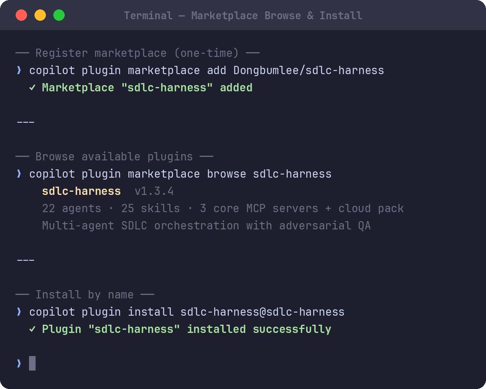

### Option B: Manual copy

1. Copy `.github/agents/`, `skills/`, `.github/prompts/`, `.github/instructions/`, `.design/`, `.vscode/mcp.json`
2. Set `<PROJECT_NAME>` in `.github/copilot-instructions.md`
3. Select quality instruction files matching your stack

### Adoption checklist

- [ ] Install plugin or copy files
- [ ] Initialize the workspace from the Harness (see [First use](#first-use))
- [ ] Review `.github/copilot-instructions.md`
- [ ] Start MCP servers; on VS Code, open a new chat session
- [ ] Enable branch protection on `main`

Once it runs, make the standards yours — the quality instructions,
reference catalog, and templates the harness deploys are your files to
edit, and the gates enforce your text. See
[Adopting the Harness](docs/adopting.md) for where each standard lives
and how a change takes effect.

---

## Contributing

Development happens on `main`, through pull requests. Start with
[CONTRIBUTING.md](CONTRIBUTING.md) — where things live, the verification
battery every change runs before it is proposed, the repository structure
and CI checks, and the conventions (including the written scope freeze
every release is cut with).

Settled design decisions are recorded as ADRs in
[`docs/adr/`](docs/adr/) — [ADR-0001](docs/adr/ADR-0001-pack-separation.md)
(pack separation), [ADR-0002](docs/adr/ADR-0002-bundled-default-templates.md)
(bundled default templates),
[ADR-0003](docs/adr/ADR-0003-github-native-operations.md) (GitHub-native
operations). Read the relevant ADR before proposing a change to a settled
design.

The harness also validates itself: 60 canary specs exercise the pipeline
end to end and every skill carries a frozen evaluation spec — see
[bench/](bench/README.md).

---

## License

MIT
