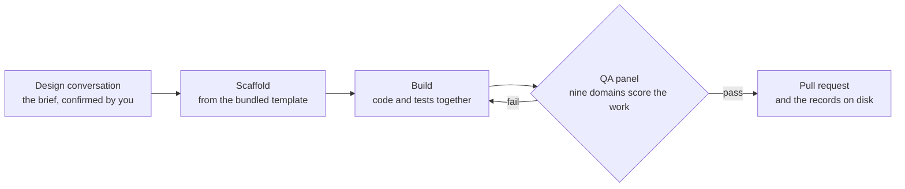

# Your First Run

The smallest useful way to meet the Harness: one small, local job, end
to end. No cloud account, no deployment — a Python command-line tool
built on your machine, through the same phases and gates a large
project gets, at the ceremony size a small job earns.

This is a walkthrough of the Small path as the Harness defines it.
For a complete delivery with deployment, the
[Hands-On Guide](hands-on-guide.md) walks a full Large run; this page
is the five-minute version.



## Before you start

- The plugin installed and the workspace initialized — the
  [Quick Start](../README.md#quick-start) covers both, in that order.
- An empty folder (or a fresh repository) for the new project.

## The job

A tiny CLI: it reads text and prints a URL slug.

```
/agent harness
Build a small Python CLI called slugline: it takes text and prints a
URL slug — lowercase, spaces and punctuation become hyphens, repeated
hyphens collapse. Exit code 0 on success, 2 on empty input. Include
tests.
```

## What happens

### 1. The design conversation

Nothing is built yet. The Harness talks the job through with you and
writes the brief down: what will be built (the slug rules, the exit
codes), what will not (no file input, no configuration, no web
service), and the limits. You read the brief and approve it — or
correct it. Work starts only after that approval.

### 2. The grade: Small

At intake the Harness grades the run. One component, a handful of
operations, no integrations — this is **Small**, and the grade is
recorded in the project's manifest where every later step can see it.
Small changes the ceremony, not the standards:

- Requirements and design consolidate — one Analyst session per
  phase instead of the full sequence, and one combined exit review.
- The budget envelope is the Small one: caps of $20 of model spend
  and 4 hours of active run time (the
  [Quick Reference](quick-reference.md) has all three grades). Caps,
  not a prediction — how long the job actually takes depends on the
  model seat you run it on.
- The Phase 6 QA panel does **not** shrink. Small work is reviewed
  by the same nine domains as large work.

### 3. Scaffold and build

The Scaffolder starts from the bundled Python CLI template — the
project layout, test setup, and packaging are the tested shape, not
invented for the occasion. The Implementer then writes the tool and
its tests against the approved brief: the slug rules as functions,
the exit-code map (0 success, 2 empty input) wired into the entry
point, and a test for each rule.

### 4. The QA panel

Nine reviewers who took no part in building check the result in
parallel — architecture, code quality, security, test coverage,
requirements completeness, and the rest — each scoring 1–10 against
the project's own standards. Security must reach 8, every other
domain 7, and any Critical finding fails the run outright.

If a domain falls short, the findings go back to the builder and
only the changed parts are re-checked. A Small run gets up to two
rounds to converge; if it still fails, the decision is yours, with
the report on the table.

### 5. What you end up with

- The working CLI and its tests, in the scaffolded project layout.
- A pull request prepared by the Release Manager — merging it is
  your call.
- The paper trail, in files: the approved brief and requirements,
  the ADR recording the design choices, the QA report at
  `docs/QA-Review-Report.md`, and the manifest ledger showing every
  phase Complete — each one moved there by a gate that checked the
  artifacts on disk, not by a session saying "done".

Close the session and reopen it tomorrow: the run's state is in
those files, and the Harness resumes from the record.

## Where to go next

- The day-to-day loop, with sequence diagrams:
  [Workflow Guide](workflow-guide.md).
- A full delivery — three services, deployed, Large grade:
  [Hands-On Guide](hands-on-guide.md).
- The numbers behind this page — thresholds, round caps, envelopes:
  [Quick Reference](quick-reference.md).
- Making the standards the Harness enforces your own:
  [Adopting the Harness](adopting.md).
